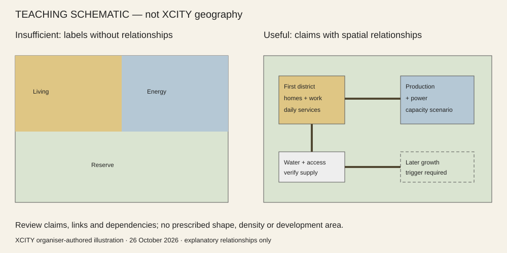

# Annotated design-evidence examples / 参考成果与常见错误

**Source and status:** XCITY organiser-authored teaching diagrams, 26 October 2026. These are invented schematic relationships, not a surveyed XCITY site, competition entry, engineering design or a pre-approved compliant city. They demonstrate how evidence can answer a question. They do not supply a form to copy. No third-party project imagery or unverified precedent claims are used.

## 1. Whole-site structure: connected argument versus coloured zoning

**Useful evidence:** name the settlements/centres and explain their roles; show where production and conservation go, approximate capacities and the resource/transport links supporting them. Distinguish the first works from later expansion. Put the water/grid/access assumptions beside the links and state alternatives considered. A reserve can be the right answer if its role and relations are explained.

**Insufficient:** three large coloured areas labelled living/energy/nature, without centres, system capacity, access, resource dependencies or phase links. Boundary coverage alone does not make a plan. The left/right teaching comparison illustrates the information difference, not a preferred layout, density or construction area.

**Review test:** trace a resident's journey to services/work and the associated water/power/service dependencies. If this cannot be traced, another colour or perspective will not fix it.

## 2. Complete phase one and urban-design enlargement

**Useful evidence:** the first district plan locates housing, jobs, daily services, safe access, production logistics, water/waste/power and the first funded works. A block enlargement shows entrances and servicing, public/private edges, building heights, shaded walking and a decisive cross-section. Quantities reconcile with the same phase-one metrics. Explain what happens if phases two and three never happen.

**Insufficient:** a boundary labelled phase 1 enclosing housing blocks whose school, water plant, jobs and road exist only in phase 3. A set of building footprints without street edges, entrances, shade or public-space relationships cannot establish urban design.

**Review test:** hide later phases. Can daily life and production function? Follow a person on foot and a service vehicle across the enlargement. The solution may be compact, dispersed or another justified form.

## 3. Node plan/section versus decorative concept image

**Useful evidence:** a node plan explains location and access, entrances, users and activities; a section cuts the actual conflict (shade/clearance/slope/level or human-machine interface). Mark dimensions and heights as design choices, not measurements. Explain its time-of-day operation. Concept views use the same geometry and remain illustrative. A logistics node and a public courtyard need not have identical drawing sets.

**Insufficient:** a beautiful generic desert courtyard unrelated to the node boundary, no service route, no entrance, and a section cut elsewhere. Three near-identical aerials do not show operation. An image can be compelling and still provide no verifiable spatial answer.

**Review test:** use the plan to locate the camera and section; trace a user's route and a service/robot route. Ask whether the section answers the important conflict. Keep that formal plan/section in the main booklet; put raw screenshots and repeated control comparisons in the appendix.

## 4. Honest uncertainty versus fabricated certainty

**Useful evidence:** “Water entitlement and grid connection are not supplied; these capacities are explicit scenarios. Verify with the relevant owner/operator before implementation.” Link the assumptions, relevant metric and geometry in the depth matrix, with the next verification and responsible specialist.

**Insufficient:** turning the flood-sensitive screening into a permanent lake or blanket exclusion, claiming guaranteed utilities from a proximity map, or marking every design question passed because files exist.

This reference is an annotated evidence standard, not a full compliant example submission. The existing example submission teaches file format only and is not silently relabelled a quality benchmark. Technical integration is tested with the isolated synthetic package described in `scripts/test_design_depth.py`; it never represents a spatial design approved by the organiser.
