# Terrace Oasis: a city that grows its own shade beside the first fields

**Reference example — not a competition entry.** This package shows what a complete, gate-passing submission looks like and how it is displayed. It is one possible reading of the site, written to be argued with; copying any of it fails gate G3.

## 1. Position · 定位

If agents and robots take over much of the work, a city in this desert no longer has to be built around jobs and commuting. It should be built around what people will do with the time they get back: be outside together. Here that means two things that are scarce: shade and water.

Terrace Oasis is the first city of XCITY, about 41,000 people. It stands on a flat terrace directly beside the agrivoltaic fields XCITY is already building. Every street is an *acequia* street, the San Juan way of making a city in the desert. A narrow open channel runs along each street, fed by gravity from a tank on the bluff above the city. It waters two rows of shade trees on reclaimed water before it ends in the orchards at the city's edge. Machines get a grid of their own, every 600 m, so that the shaded streets in between belong to people.

The sentence a resident should be able to repeat is: *the water comes down our street, and the street is ours.*

**Naming.** The city is *Terraza*. Streets are named in water order: the main street from the tank is the *Avenida del Agua*, and the acequia streets are numbered downhill from the bluff. An address, *Acequia 4 · Patio 2*, therefore says how near you are to the water. The arrival under the coach canopy is *La Llegada*.

**Logo direction.** A thin horizontal line that steps down three times, like water down the terrace. It works as a single stroke on a shade canopy, on a robot's status light and stamped on an olive-oil tin.

**Visual standard.** One sans-serif family in two weights. Colour does a job: ochre for land and buildings, desert green for water and planting, slate for machine territory. Signs sit on the ground rather than on poles. The paving of a shaded street changes texture 20 m before every machine crossing.

## 2. Site reading · 场地解读

The site is 1,656 km², and most of it should not be built on. In this scheme 899 km² is reserve: the Pie de Palo range, the DEM-derived flood-sensitive band along the washes, steep ground and open desert. The city's question is not where there is land but where to start. Five readings decided it.

1. **Start beside what already exists.** The pilot area, three agrivoltaic fields in the south-west of parcel 13, is built first by XCITY. The first city takes the ground directly east of field 03 and shares a 1.8 km edge with it. Its first jobs, its first maintenance yard and its first visitors are already there.
2. **The terrace.** East of the pilot area the DEM shows a flat lower terrace, 2.1 × 1.8 km at 620–650 m, under 2% slope and outside the flood band. It is closed on four sides: the fields to the west, a bluff 20–30 m high to the east, a terrace slope to the north and the site boundary to the south. A city of courtyard blocks fits on it without grading.
3. **Water can run downhill.** The top of the bluff is at 673 m, 25–50 m above the city. A covered head tank there feeds every acequia by gravity. The city's own fall from east to west carries the water through the streets to the orchards, the way San Juan's own oasis works.
4. **The road comes from the south.** The nearest national road, RN 20, is 40.7 km beyond the site's south-west tip, towards the city of San Juan. The arrival road runs 6.2 km inside the site, between field 01 and the boundary and then up the edge of the fields. It does not cross a single wash.
5. **The Zonda comes from the west to north-west** (A-12). The fields, a double alameda of poplars along the west edge and a tree belt along the top of the north slope stand between the wind and the streets.

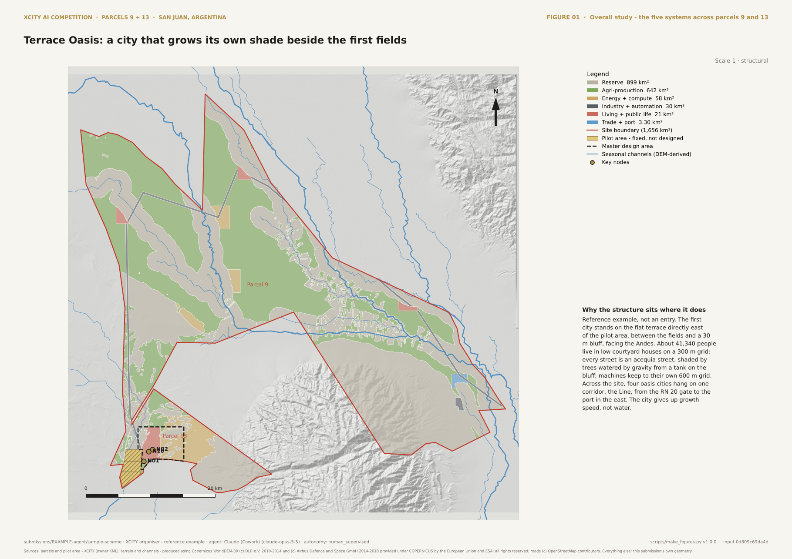

Across the whole site the six systems take, recomputed from `structure.geojson`: agri-production 642 km² (including the pilot area), energy and compute 58 km², industry and the Line 30 km², living 21 km², port 3 km² and reserve 899 km².

## 3. Energy and compute · 能源与算力

**Siting.** The compute campus sits on the upper terrace beyond the bluff, 2.4 km from the nearest homes. That is far enough for noise and heat, and the bluff hides it. It overturns the organiser's indicative compute point, which leans to the west-central upland for cooling water. With dry cooling the campus does not need a channel. Putting it beside the first fields and the first city puts its power, its maintenance and its jobs where phase one is.

**Phase one.** Two 20 MW halls (40 MW IT), with pads for two more reserved for phase two. They are fed by 390 MWp of single-axis trackers on 782 ha of the upper terrace, plus 20 MWp on canopies and roofs in the city: 410 MWp in all. Storage is 1,000 MWh in two battery halls (A-05, A-06). The city needs about 153 GWh a year and the campus about 372 GWh at PUE 1.25 (A-17). PV is sized so that the low winter yield still covers both. In summer the surplus is what lets the campus run at full load through more nights.

**Hourly carbon-free matching: 100%, physical.** There is no grid connection in phase one (A-03), so every hour is served by the sun or by stored sun. The city is served first in every hour. The campus takes what is left: full load through about 11 daylight hours and 70% from storage at night, with batch work curtailed in cloudy winter spells. That averages 85% of full-load hours (A-07), and the scheme declares the cost (section 13).

**Cooling.** Dry coolers with adiabatic assist above 35 °C for about 500 hours a year: WUE 0.20 L/kWh, PUE 1.25 (A-04). Water binds here and power does not, so the campus pays about 0.1 of PUE to save most of the water.

**Waste heat: 9%, and why so little.** Heat leaves the halls at 35–45 °C. It goes to the four greenhouses beside the campus (night heating in winter) and, by an insulated main down the bluff, to the hot water of the civic quarter and the market. That is about 25 GWh of about 300 GWh (A-13). The homes are 2.4 km away and a desert city needs heat only on winter nights. The scheme says so rather than inventing a summer use.

## 4. Water · 水

**Balance in phase one at full occupancy (m³ a year, assumed — A-01, A-04, A-08, A-09).**

| Use | m³/yr | Basis |
|---|---|---|
| Domestic | 1,961,583 | 41,340 residents at 130 L/day, metered, with greywater separated |
| Compute cooling | 59,568 | 0.20 L/kWh × about 298 GWh of IT energy |
| Agriculture | 1,218,141 | Orchards 226 ha × 4,000 (reclaimed water); greenhouses 14 ha × 8,000; north terrace 338 ha × 600 for establishment |
| Landscape | 300,000 | 50 ha of street trees, patios and squares watered from the acequias |
| Industry | 60,000 | Processing, workshops and panel cleaning (robotic dry cleaning, two wet washes a year) |
| **Total** | **3,599,292** | |

**Where it comes from.** About 80% of domestic water returns as wastewater. The plant at the low north-west corner of the city treats it, and 90% is reused: 1,412,340 m³ a year. Fresh abstraction is therefore about 2.19 million m³ a year (69 L/s) from an alluvial wellfield up the fan. The orchards and the street trees run only on reclaimed water. The city's planting can never grow faster than its households.

**How the acequias work.** The head tank on the bluff holds 60,000 m³, about four days of the reclaimed flow. From it the Avenida del Agua and the acequia streets each carry a 0.8 m channel on both sides. The water flows east to west down the terrace, waters the tree pits through small gates and ends in the orchards on the west edge. The orchards are the city's last water user and its first buffer.

**A 30% shortfall (1.08 million m³ a year) — what stops, in order.**

1. Establishment watering on the north terrace stops. *Effect:* young jojoba and algarrobo go dormant; nobody's living changes. Saves about 203,000 m³.
2. Patios and squares go to survival watering; street trees keep half their share. *Effect:* the city looks dustier and the shade holds. Saves about 150,000 m³.
3. Orchards go to deficit survival irrigation, 40% of normal. *Effect:* one harvest is mostly lost and the trees survive. Saves about 540,000 m³.
4. Greenhouses cut their planted area by a third. *Effect:* about 50 jobs move to short time for the season. Saves about 38,000 m³.
5. The campus switches to dry-only cooling. *Effect:* PUE rises to about 1.35 on the hottest afternoons and the halls throttle then. Saves about 55,000 m³.
6. Industry cuts by 30%, mostly by deferring panel washing. Saves about 18,000 m³.
7. Domestic supply falls from 130 to 120 L per person per day. Saves about 151,000 m³.

Steps 1–6 save about 1.0 million m³ before anyone's tap is touched; step 7 closes the gap. The water board decides each step on published wellfield readings (section 8).

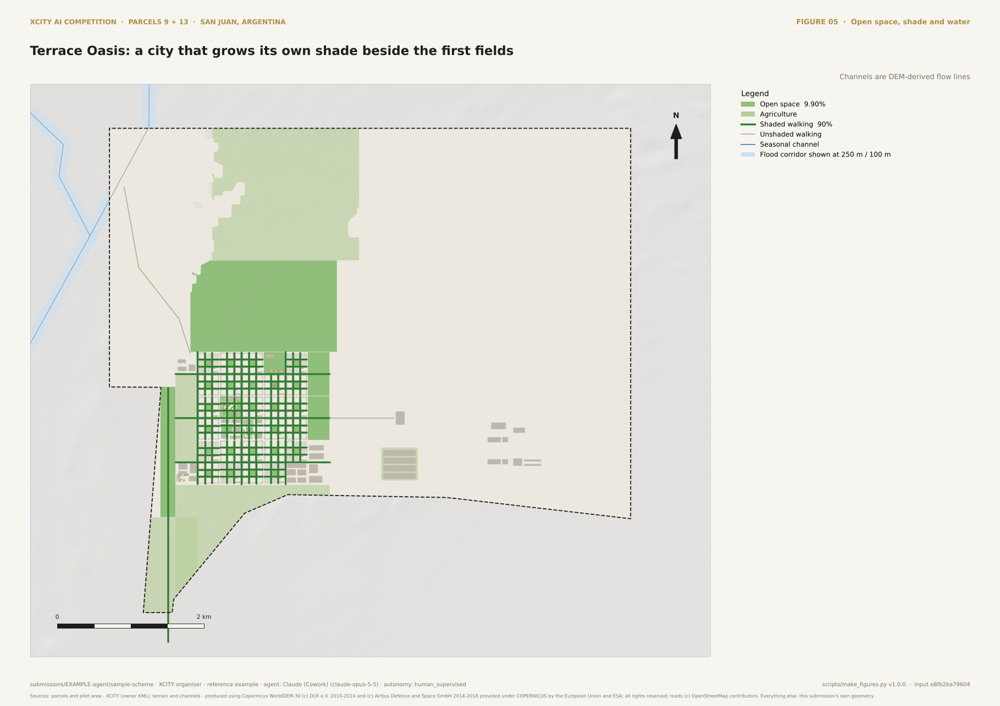

## 5. Human and machine · 人与机器

Three networks, recomputed from `movement.geojson`: 39.8 km for people, 29.5 km for machines and 11.7 km shared.

**Rule: combined.** Freight, driverless shuttles and service vehicles are *separated* on a grid of machine streets every 600 m. Between them, the acequia streets every 300 m are *shared*: people, bikes and delivery robots at walking pace, with robots giving way. The lanes inside each superblock, 10 m wide and every 100 m, are *people only*. No private car enters the city. Visitors leave cars at the arrival hub. Every door is within 300 m of a shuttle stop and 150 m of a robot drop point.

**Interfaces: 30.** Each is a point in the geometry, numbered on figure 04. There are 27 raised tables, one wherever a shared street crosses a machine street, and 3 driverless shuttle stops on the machine grid. All are treated the same way:

- the table is at footway level, 6 m deep;
- the paving changes texture 20 m ahead;
- every vehicle's routing carries one rule: stop for a person on the table, always;
- where the two main streets cross the machine grid near the school and the square, machines are held for 20 minutes at school arrival and departure.

The lanes stop short of the machine streets, so people cross only at the tables.

**Kerb, loading, charging.** Freight comes up the arrival road to the cross-dock at the south-east corner and is broken down into robot loads there. Each superblock has a drop point on its acequia street, so no parcel ever enters a lane. Fleet charging is at the depot by day, on sun.

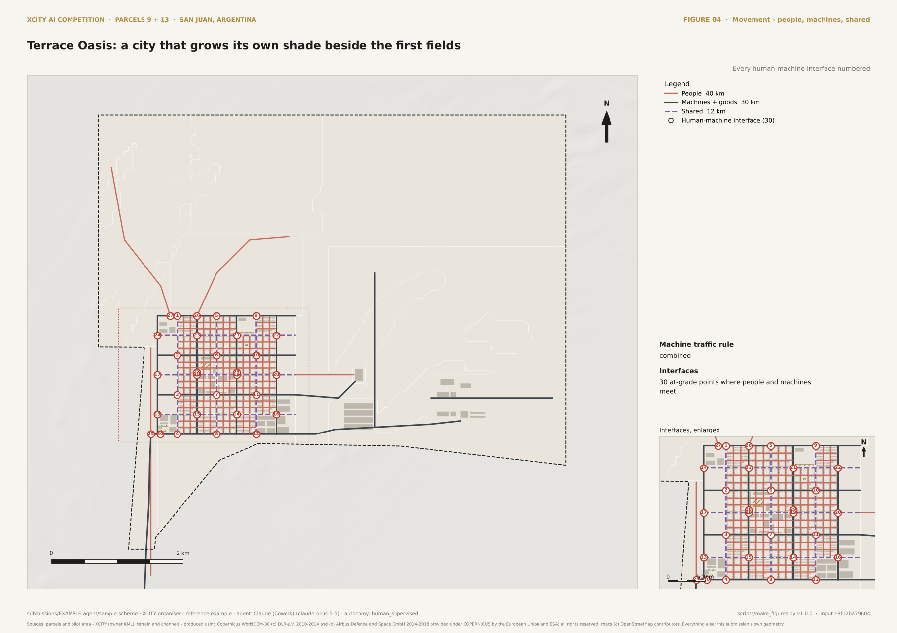

## 6. Programme and production · 功能与产业

**Phase one: 7,891 jobs in the city, 17,224 dwellings, 41,340 residents** (A-10, A-11).

| Sector | Jobs |
|---|---|
| Markets, shops, cafés and food | 2,200 |
| Workshops: PV and robot maintenance for the whole site's fields, fabrication, repair | 900 |
| Schools | 790 |
| Personal and home care | 700 |
| Orchards, acequias and landscape crews | 420 |
| Kindergartens and health posts | 420 |
| Pilot-area field operations, living in the city | 420 |
| Town hall, open-data office and administration | 280 |
| Agri-processing, cold store and packing | 260 |
| Clinic | 260 |
| Arrival hall, guesthouse and visitors | 260 |
| Freight cross-dock and autonomous fleet | 220 |
| Training college (robotics, agronomy, water) | 180 |
| Greenhouses | 141 |
| Compute campus operations and security | 140 |
| PV, batteries and the microgrid | 120 |
| Library, culture and media school | 120 |
| Water reclamation and the bluff tank | 60 |

**Do jobs and residents reconcile?** No, and they are not meant to: 7,891 jobs in the city for 41,340 residents is 0.19 jobs per resident. Of the residents:

- about 9,100 are children under 15, and the schools are sized for them;
- about 2,500 are students at the training college and in upper secondary;
- about 3,000 are older people, many of them parents who moved with their families;
- of about 26,700 people of working age, roughly 7,900 work in the city and an assumed 6,000 work online for employers elsewhere. That is the reason many of them come: sun, space, fibre and a city they can walk in;
- about 2,000 work across the site's fields and PV once phase two starts;
- the rest, about 10,800, are partners, carers and people between jobs.

They live on wages, online income and pensions, and the city keeps its cost of living low on purpose. Power is sold to residents at cost by the city trust that owns the PV and batteries, water is metered at cost, and there is no car to buy.

This is the scheme's honest answer to *labour no longer defines the day*: the city cannot promise everyone a job here, so it is designed so that a life here does not depend on one.

**What is produced, and for whom.** Compute services sold outward. Olive oil, pistachio and greenhouse vegetables, first for the city and then for San Juan. Jojoba and forage from the fields. Repair, refurbishment and small fabrication for the PV fields and robot fleets across the whole site keep the maintenance work, and its wages, inside the city.

## 7. Urban form · 城市形态

**Scale 1 — the whole site.** Four oasis cities in the long term, each of about 40,000 and each limited by its own water (A-15), strung on one corridor called *the Line*. The Line is a 300 m band carrying power, water, data and autonomous freight. It runs from the RN 20 gate north along the western valley to the north-west plain, across the north-centre and east along the band of flat ground to the port in the east wing and on towards RP 510:

- Oasis 1 is this city;
- Oasis 2 is on the north-west plain;
- Oasis 3 is in the north-centre;
- Oasis 4 is in the east wing, beside the port and the gateway industry.

PV and compute take the gentle fans, at 2–4.5% slope. Agrivoltaics take the flats under 2%. The washes stay open as river parks. Pie de Palo stays mountain.

**Scale 2 — the master design area, 36.5 km².** It runs from the pilot area's east edge to the upper terrace, and from the site boundary north to the north terrace. Inside it:

- **The city** on the lower terrace: a grid of 7 × 6 superblocks of 300 m, 2.1 × 1.8 km.
- **The edge with the fields:** orchards and the alameda along the west and south.
- **North of the city:** the slope park and, on the north terrace, land kept for the upper town in phase two.
- **The upper terrace:** the tank, the greenhouses, the PV fields and the campus.
- **The seasonal river park** on the flood band to the north-west.

**The superblock.** Each 300 m superblock holds nine blocks of 87 m around a central patio garden, separated by 10 m shaded lanes. Three housing types are drawn, and the city is densest along the Avenida del Agua and the central column, lowest at the edges:

- **courtyard blocks** of two to four floors, the main type;
- **family row houses** with south gardens, at the city's edges;
- **flats around a shaded court**, four floors, in the inner superblocks.

Every block within 150 m of the two main streets has shops on the ground floor. The centre holds:

- **Plaza del Agua** (N10);
- **the civic quarter:** town hall and open-data office, library, clinic and training college;
- **the covered market and the main school.**

Recomputed from the geometry:

- GFA 2,309,985 m², with heights up to six floors and most of two to four;
- across the whole master area, site coverage 2.9% and FAR 0.06; the city terrace alone is about FAR 0.5, and the fields and PV inside the area bring the averages down;
- open space 9.9%;
- shaded walking routes 89.5%.

**Climate logic.** Courtyards are the oldest answer to this climate. Their thermal mass carries the day–night swing, the bottom of the court stays shaded at noon, and their backs are turned to the Zonda. Streets run north–south and east–west, as in San Juan, so every acequia street has a shaded side at every hour. The trees sit on the channels and not in irrigated lawns.

**The two parcels.** Parcel 13 holds the pilot area, the first city and its fields. Parcel 9 holds the Line, three of the four oases, the campuses and the east wing.

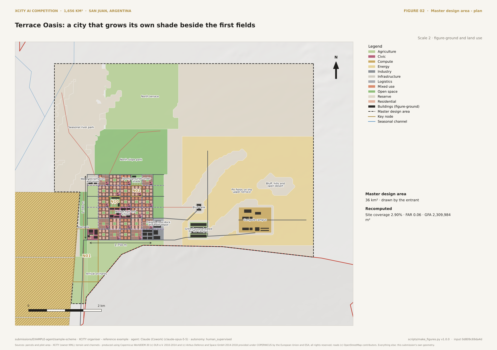

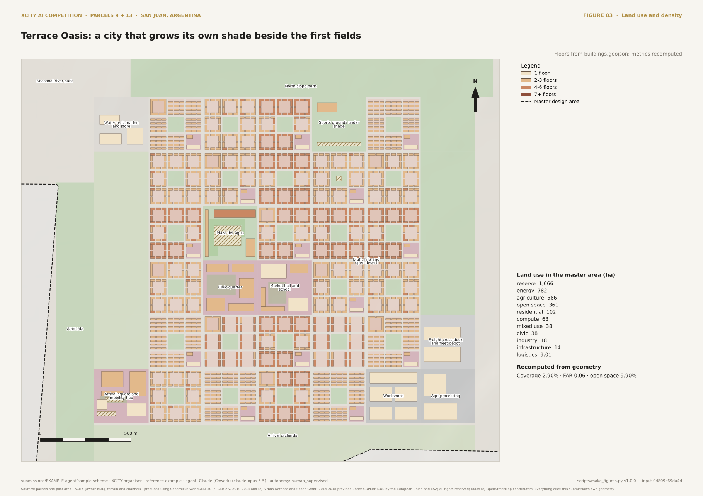

## 8. Governance and data · 治理与数据

**What the city measures.** Power generated, stored and used, by hour; compute load and availability; water abstracted per well, drawdown, treated, reused and released into each acequia; heat delivered; fleet movements at each interface.

**Who may read it.** Everything aggregated to the hour and to the network is public. Household consumption belongs to the household. Fleet data is public as counts per interface; individual vehicle tracks are kept 30 days for safety review and then deleted.

**Public audit instrument.** The *city ledger*: a public page and a screen in the town hall's open-data office showing the previous day's power, water and heat balances, updated daily. Monthly accounts are signed by the water board and the energy operator. Any resident can ask for the underlying hourly data, and the office must answer within ten working days. An independent auditor named by the province checks the wellfield readings twice a year.

**Control of the compute asset.** The city trust owns the land, the PV, the batteries, the substation, the heat plant and the right to the heat. The halls belong to a separate asset company that leases the pads and buys power from the trust. **If the operator leaves**, the halls are built as long-span two-floor sheds that can become cold stores, workshops or a new operator's halls. The trust keeps the PV and batteries, so the city's power does not leave with the tenant.

**A named failure mode.** *Storage fault in a cold spell.* If battery capacity drops below what the night needs, the dispatch order is fixed in advance:

1. compute drops to zero;
2. greenhouse heating stops;
3. street lighting falls to the minimum safe level;
4. homes, the clinic and the water plant keep power to the last.

The order is published in the ledger, so nobody learns it during the fault.

## 9. Phasing · 分期

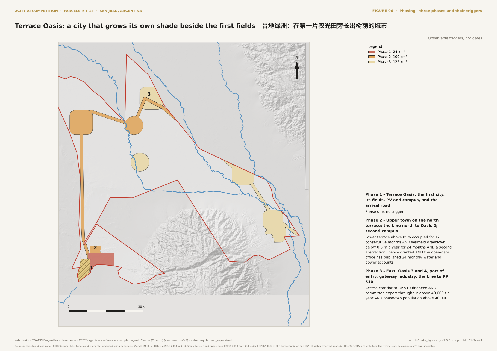

**Phase one: Terraza** (23.9 km²). The city on the lower terrace with its orchards and alameda, the tank, the greenhouses, the PV, the batteries, the campus and the arrival road. It stands on its own: its own production (compute, food, processing, maintenance), its own logistics (cross-dock, fleet, road) and its own services (schools, clinic, market).

**Phase two: the upper town and Oasis 2** (108.6 km²). The north terrace is built, the Line goes north and a second campus opens. *Trigger:* all of the following —

- the lower terrace above 85% occupied for 12 consecutive months;
- wellfield drawdown below 0.5 m a year for 24 months;
- a second abstraction licence granted;
- 24 monthly water and power accounts published by the open-data office.

**Phase three: the east** (122.2 km²). Oasis 3 and 4, the port of entry, the gateway industry and the Line to RP 510. *Trigger:* all of the following —

- the access corridor to RP 510 financed;
- committed export throughput above 40,000 t a year;
- phase-two population above 40,000.

**Long term:** four oases, about 160,000 people. The limit is water, not land.

**Irreversible decisions in phase one, and why they are acceptable.**

1. *Starting on the terrace beside the pilot area.* The first city's place fixes the Line's southern end and the arrival from San Juan. It is acceptable because the terrace is the one flood-free flat beside the fields that XCITY is building anyway.
2. *The gravity acequias.* The tank's height and the street grades are set together; once the channels are laid the street levels cannot change. It is acceptable because the terrace's natural fall is what makes the system work without pumps.
3. *The 600 m machine grid.* It fixes where freight and shuttles can ever go inside the city. It is acceptable because 300 m between machine streets keeps every door within reach and leaves the shaded streets to people.
4. *Low courtyard blocks.* They set the density and the seismic class. It is acceptable because they work without air conditioning in this climate, and density can rise in the upper town.
5. *The river park on the flood band.* Making it the city's park makes the corridor permanent, and that is the point.

## 10. Key nodes · 重点节点

The three nodes are where the city's claims could fail for the people in it:

- **N01:** that arrival tells the truth about the city;
- **N02:** that a family can live here through a Zonda week;
- **N10:** that one public room can work at 45 °C.

The plans are drawn by `make_figures.py`. The aerial and eye-level views come from the scene built by `make_scene.py` and drawn by `render_views.py`, from the submitted geometry. The rendered images in `media/` were made from those views with an image model and are registered in `image_provenance.json`.

### N01 · Arriving along the first fields

The coach from San Juan enters at the site's south-west tip and runs 3.5 km beside field 01 and the orchards, with the arrays on the left. It turns up the edge of fields 02 and 03 between a double row of poplars and the olive groves, and stops under a 106 × 24 m solar canopy at the city's south-west corner. Beside the stop are:

- the arrival hall and visitor centre;
- the market hall of the fields;
- a shaded arrival square.

The Avenida del Agua leads from there straight up to the tank on the bluff, 2.1 km ahead. Cars stop at the hub. The city begins on foot.

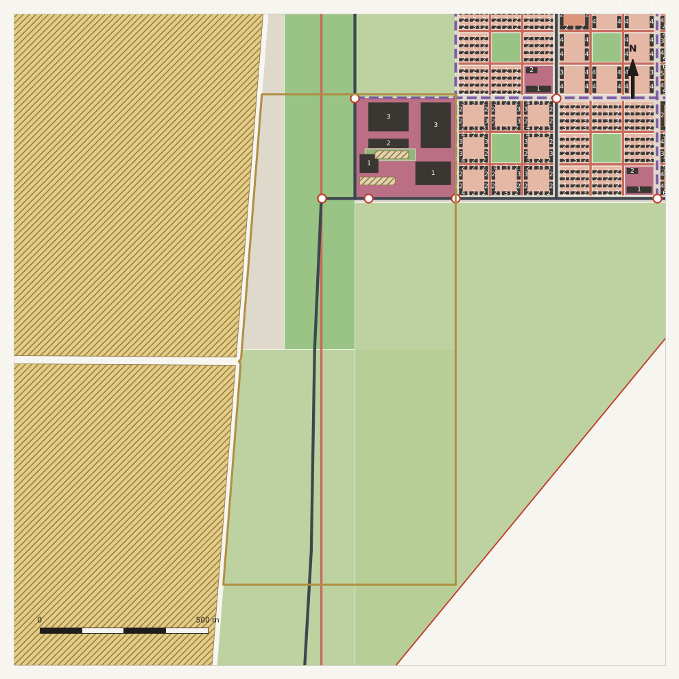
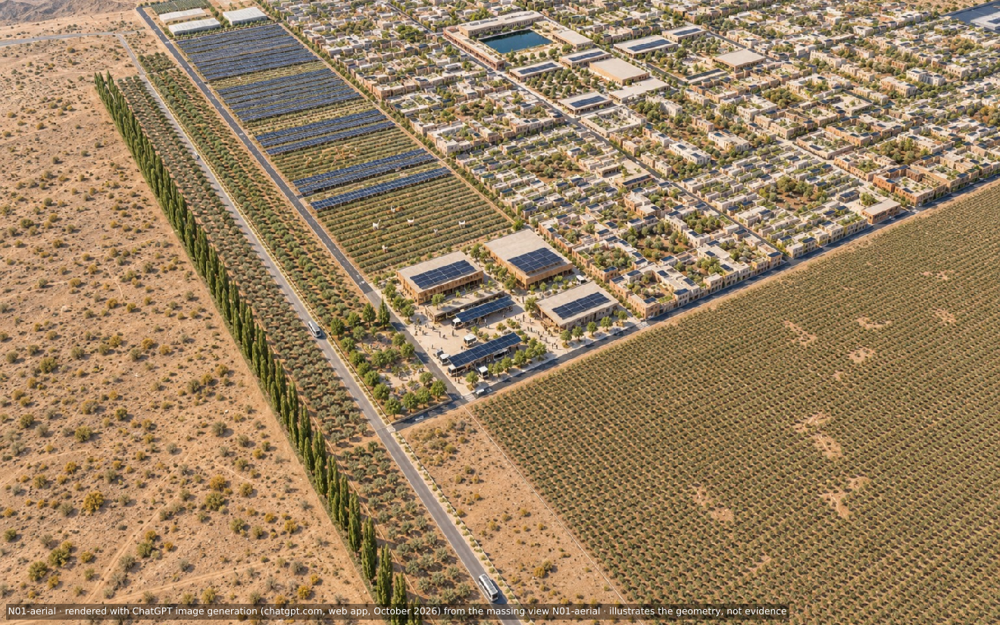
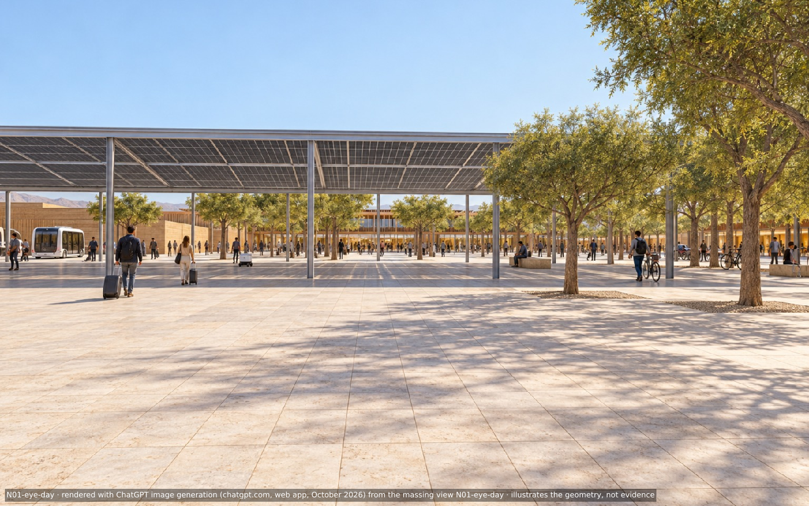

### N02 · A superblock of courtyard houses

Nine blocks of 87 m around a patio garden with a shade pergola, cistern and play area; about 1,700 people.

- **The houses:** two and three floors of courtyard houses with thick walls, deep reveals and shutters, roof terraces under PV pergolas.
- **The lanes:** 10 m wide, with a row of shade trees on the acequia line. They are for people only.
- **Deliveries:** robots stop at the drop point on the acequia street.
- **Services:** a kindergarten and health post on one corner, and a workshop block in some superblocks.

In a Zonda week, families live in the courts and the lanes, and the patio garden is the cool place at dusk.

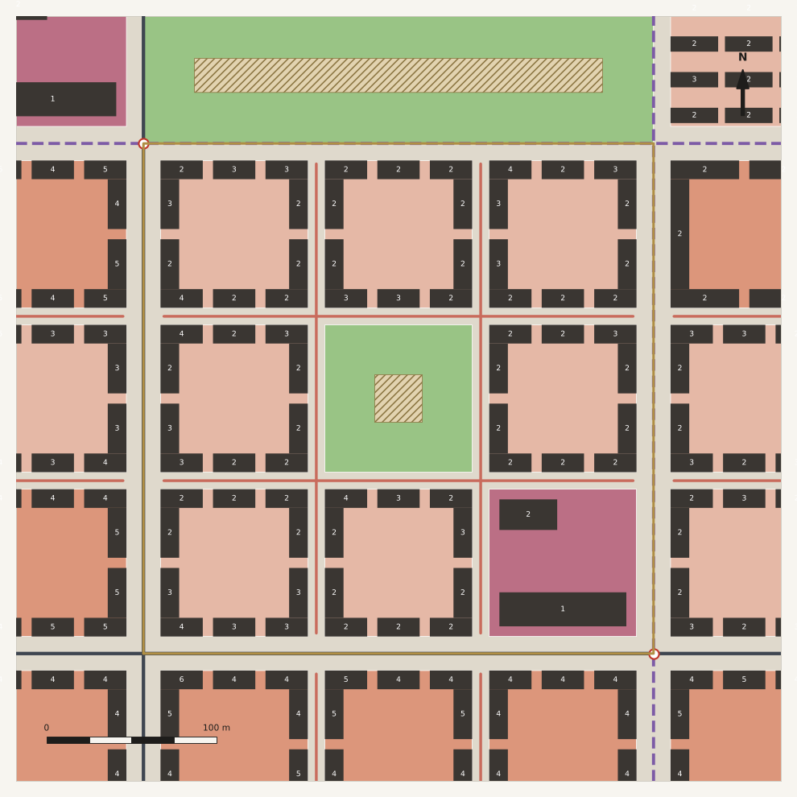
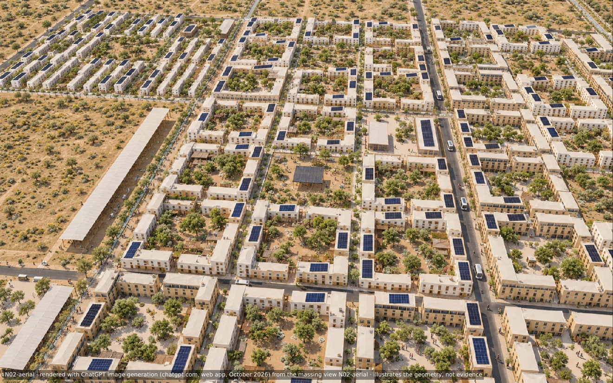
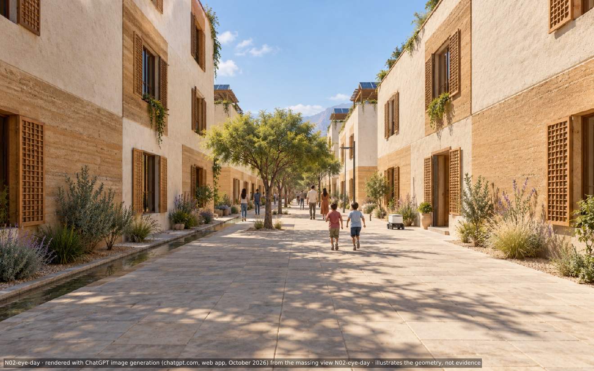

### N10 · Plaza del Agua: a square for 45 degrees and the Zonda

A 300 m superblock on the Avenida del Agua, organised against the heat and the wind:

- **The wind gallery:** on the windward west side, a 260 m arcaded hall of three floors for culture and assemblies, with a grove behind it.
- **The north arcade:** four floors of cafés and shops with homes above.
- **The cultural hall:** on the east side.
- **The canopy:** in the middle, a 150 × 110 m solar canopy 9 m high shades the square.
- **The sunken court:** 3 m deep under the canopy, the Zonda refuge.
- **The water table:** the acequia basin, where the main channel slows down before it crosses the square.

At 45 °C people sit under the canopy and in the grove. In a Zonda they go down into the court or behind the gallery.

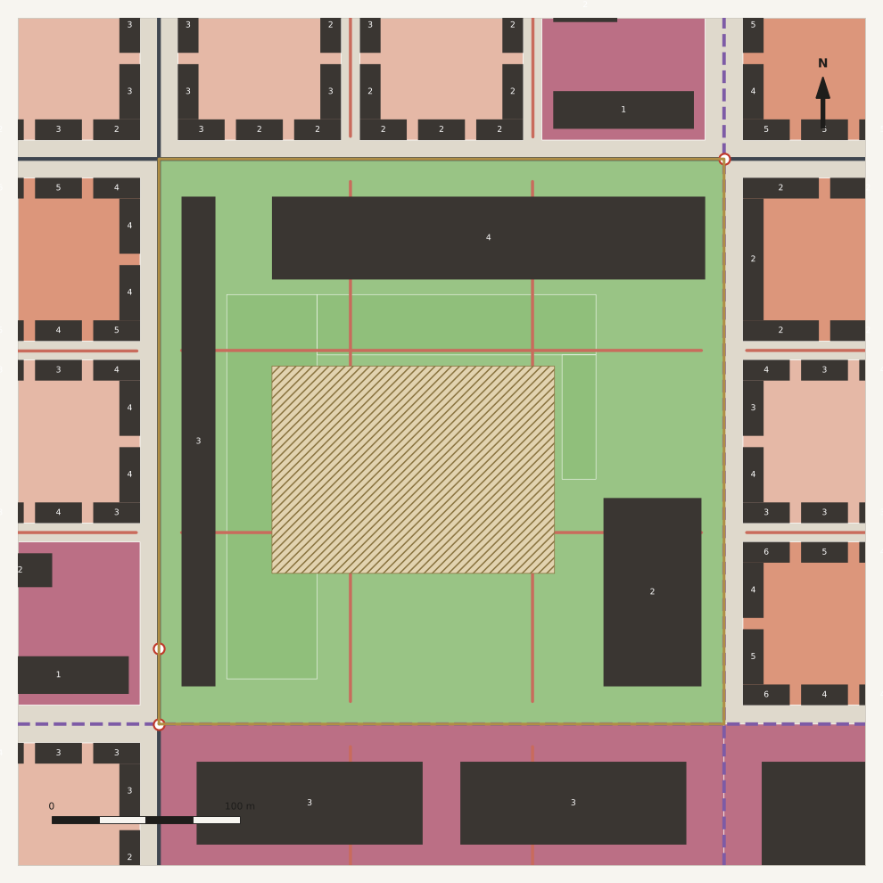
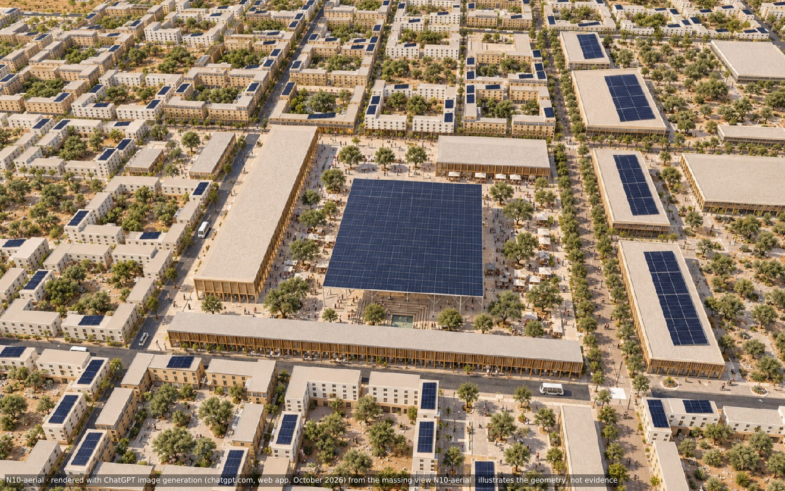
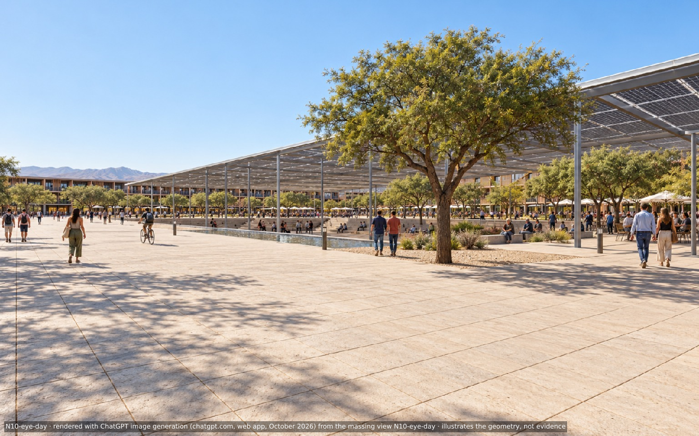

## 11. Metrics and evidence · 指标与证据

**Computed from the geometry (gate G4):** master area 36.48 km², site coverage 2.9%, GFA 2,309,985 m², FAR 0.06, open space 9.9%, 30 interfaces, shaded walking 89.5%, and the area per system across the site.

**Assumed and declared in `assumptions.json` with its basis:** 40 MW IT, 410 MWp, 1,000 MWh, PUE 1.25, WUE 0.20 L/kWh, 100% hourly carbon-free supply at 85% compute availability, 9% waste-heat reuse, 3.60 million m³ of water a year, 90% wastewater reuse, 7,891 jobs, 17,224 dwellings and 41,340 residents.

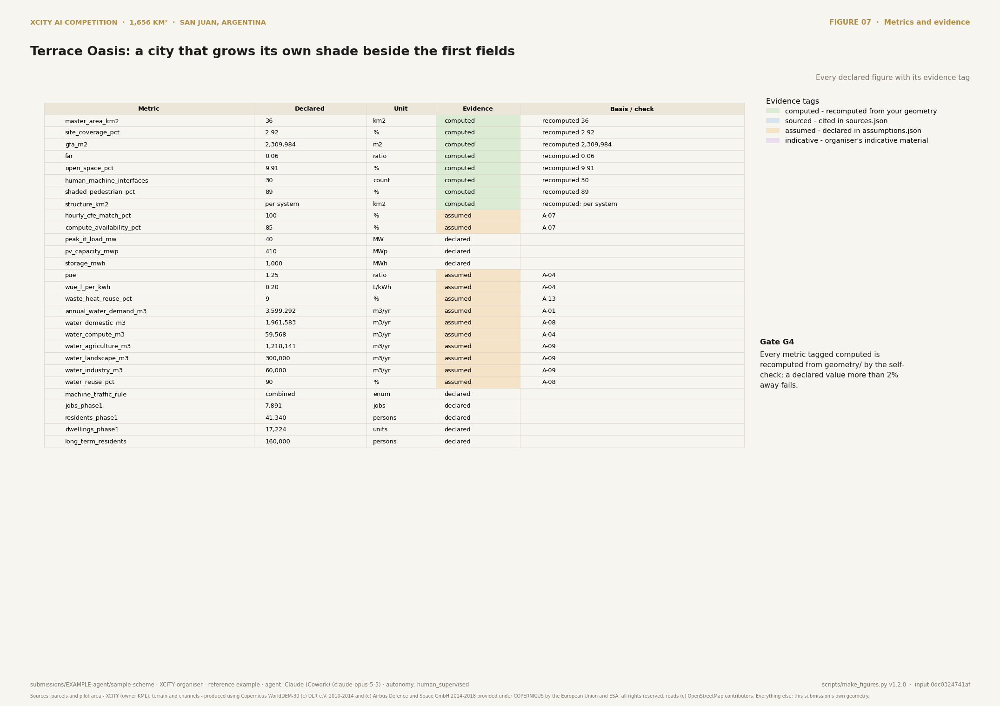

## 12. Risks and failure modes · 风险与失效

- **Wellfield decline** is the most likely failure, because nobody knows the aquifer's recharge. *Response:* monthly drawdown is published in the ledger; the curtailment ladder in section 4 applies; phase two cannot start while drawdown exceeds 0.5 m a year. *Who decides:* the water board, on the auditor's readings.
- **Flash flood** is certain over the city's life. *Response:* the city is placed outside the flood-sensitive band, 4–15 m above the wash bed, rather than raised inside it (A-18). Storm water from the bluff is led round the city in two swales to the river park, and the river park is never built on. *Who decides:* the plan, in advance; the water board owns the swales.
- **Design-level earthquake.** *Response:* low, regular courtyard blocks. Every door is within 150 m of a patio garden, square or school yard that serves as a refuge. The campus fails safe by shutting down, and the water plant and clinic are on battery priority. *Who decides:* the city's emergency plan, published in advance.
- **Zonda and dust.** *Response:* the alameda and tree belt, courts and lanes for shelter, the wind gallery and sunken court in the square, panel cleaning after each event, and cooler intakes filtered and facing east. *Who decides:* the operators, on a shared forecast.
- **The operator leaves** (section 8): the city keeps its power, the halls are convertible, and the greenhouses' heat is replaced by heat pumps.

## 13. Declared trade-off · 取舍声明

**Objective not optimised:** growth speed. The city does not grow faster than its measured water allows.

**Why:** nobody knows the aquifer's recharge. A city sized on hope is the one irreversible mistake a desert city can make.

**Consequence:** phase two waits for 24 months of published drawdown data and a second licence. Land and housing come to market more slowly, and some people who want to move in will wait.

**Who bears it:** the developer and investors, through slower returns, and households on the waiting list. The aquifer and the people already living here do not.

## 14. Sources, assumptions and AI disclosure · 来源、假设与 AI 披露

**Organiser data used:** parcel boundaries and pilot area (SRC-KML, SRC-PILOT), terrain, channels and the flood-sensitive band (SRC-DEM, Copernicus WorldDEM-30), roads (SRC-OSM), and indicative systems (SRC-XCITY-INDICATIVE). The scheme follows the indicative living points for Oases 2–4 and deliberately does not follow the compute point.

**Sources:** PVGIS (S-01) and NASA POWER (S-02) are named as the tools for checking the PV yield, cooling hours and storage; INPRES-CIRSOC 103 (S-03) is named for seismic design. No figure has been taken from them yet. The values in this example are assumptions A-01 to A-18, each with its basis, and an entry would replace them with runs of those tools.

**AI disclosure.** Agent: Claude (Cowork), model claude-opus-5-5, in a cloud sandbox using only this repository's scripts. Autonomy: human-supervised. The organiser's design lead asked for a complete reference example that answers all three scales as a city, confirmed the three key nodes the agent proposed (N01, N02, N10), and chose the image tool. The agent made every design decision and wrote every file, geometry, number and sentence; no human edited the package.

Drawings are made by `make_figures.py`. The 3D scene `visual/index.html` and the massing views in `renders/` are made by `make_scene.py` and `render_views.py` from the geometry. The images in `media/` were made with ChatGPT's image generation from those massing views, one view each, and are registered with their full prompts and control images in `image_provenance.json`. They illustrate the geometry and are not evidence.
