# THE EVERYDAY CITY

Homes, shared ground and public life before production-led expansion.

Responsible: Jingyuan Huang / jingyuanhuang-design. Independent concept review, 27 October 2026.

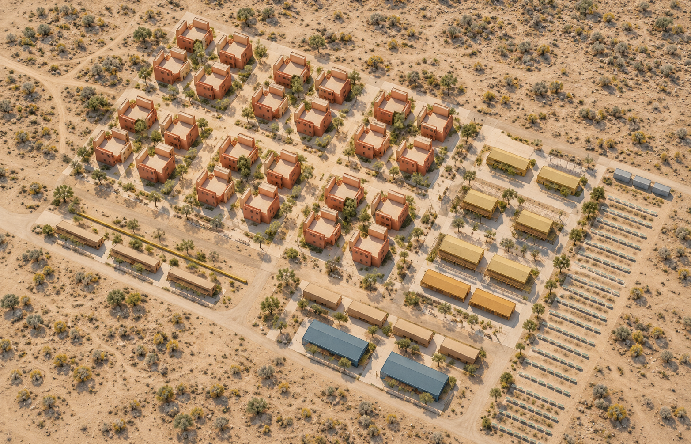

## 1. Position

The Everyday City begins with a simple obligation: a home, a school, a clinic and a public place should remain useful when a compute tenant changes its business. Housing and public life therefore organise the city. Production serves its edges and contributes jobs, training and infrastructure without determining who has a right to live here.

This is a distinct new proposal, not a revision of the published Finite Water City. Its architecture is six neighbourhoods, each composed of four open-corner courtyard units, connected to an everyday services spine. The whole-site plan covers the issued 1,656 km2 nominal competition extent; the first district is a designed part of that structure, not a substitute for it.

The deliberately compact first district contains 1,440 dwellings, 3,600 residents and 1,500 jobs as declared programme scenarios. It can stop after phase one. Future town symbols are conditional capacity studies, not housing already designed or approved. [A-HOMES; A-GROWTH]

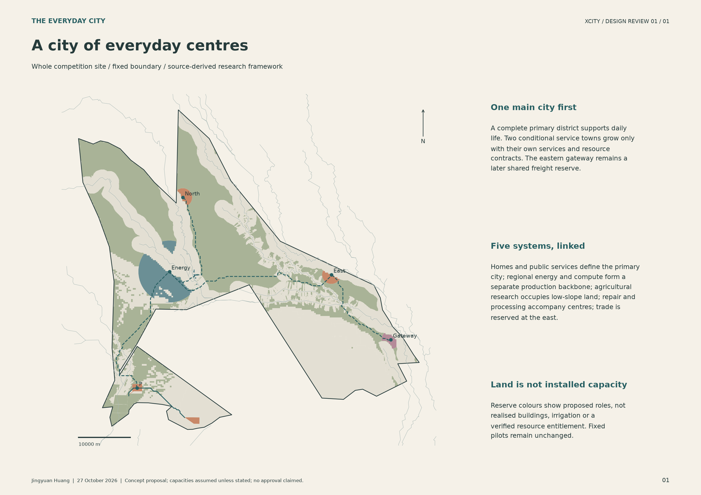

## 2. Site reading

The issued owner-derived boundary has a current geodesic area of 1,656.684229 km2. The 13.9 km2 agrivoltaic fields and the 2.48 km2 fixed first living-quarter outline remain separately classified and unchanged. Their interiors, existing population and utility capacity are not invented. [SRC-KML; SRC-PILOT; S-SNAPSHOT]

The 60 m DEM, derived seasonal channels and flood-sensitive screening provide regional evidence, not survey or hydraulic certification. Screening is not a lake and not a blanket permanent no-build rule. Permanent new buildings avoid the supplied channel research screen; small washes, design flows and actual setbacks still require field work. The newly closed internal seam does not acquire flood-safe status merely by its topology correction. [SRC-DEM; A-TERRAIN]

Three identical programme-fit tests compare slope and proximity. The selected district has about 2.64% mean screened slope and a roughly 1.1 km nearest geometric relationship to the farm pilot. Alternatives at 1.26% and 1.86% mean slope lie about 3.0 and 2.6 km away. The selected option accepts harder grading to make a working farm interface more credible. Its rectangular core is a programme fit; its overall research boundary also follows the actual farm-connection corridor. Detailed grading could change it.

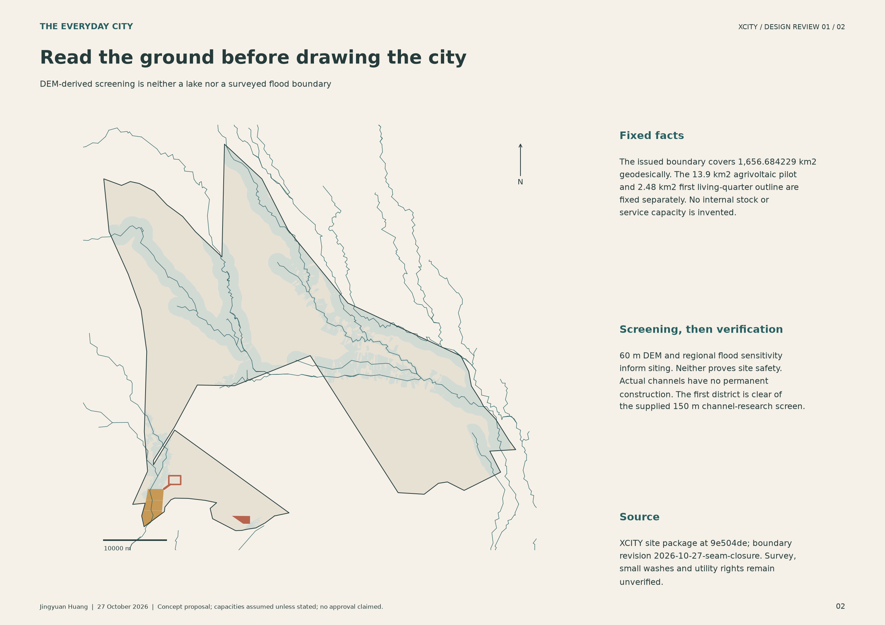
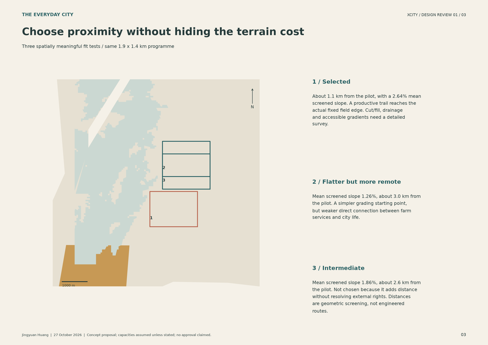

## 3. Energy and compute

A declared 8 MW daytime and 4 MW nighttime IT profile gives 6 MW average and 52,560 MWh/year IT electricity. PUE 1.30 and WUE 0.015 L/kWh are equipment procurement and operating targets, not vendor commitments. Closed-loop liquid cooling with dry rejection avoids evaporative cooling towers; high heat increases electricity demand and can reduce available IT output. [A-ENERGY]

The scenario provides 20 MW PV, a 180 MWh battery, 95% charging/discharging efficiency and a 20 MW grid limit. A protected reserve of 72 MWh usable electricity serves an assumed 1 MW essential load for 72 hours; it does not certify a resilient hospital or a fully independent island. The initial battery starts at this protected reserve, so unaccounted initial energy earns no clean-energy credit. The first-phase PV target combines 16 MW on building roofs and 4 MW on utility-yard canopies, assuming 220 W/m2 module power density and about 90,910 m2 total panel surface. Roof availability, structure, fire access, dust and yield require equipment engineering; the later regional reserve is not counted as first-phase supply. [A-ENERGY]

An explicit synthetic 8,760-hour simulation gives 29.829% fully carbon-free matched hours and 54.380% clean energy by annual quantity. These are different measures. Grid import is 35,966.6 MWh and its peak is 11.80 MW in this scenario. The solar series and periodic dust events are assumed, not site measurements. Grid electricity receives no unsupported carbon-free credit.

Two compute halls sit on a separate service loop. Four cooperative workshops and a named heat-reception building target 2,628 MWh/year usable heat, or 5% of IT electricity. Crop-processing demand, temperature lift, pipe losses and seasonal contracts determine whether this works; failed heat reception is disclosed and falls back to dry rejection. [A-HEAT]

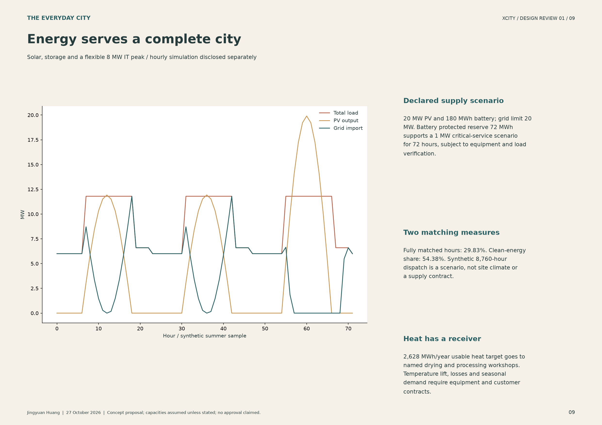

## 4. Water

The phase-one gross-use scenario is 891,748.4 m3/year: 183,960 domestic/public, 788.4 compute, 650,000 agriculture, 12,000 landscape and 45,000 industry. Domestic/public use assumes 140 L/person/day. Agriculture includes an unverified 600,000 m3 fixed-pilot placeholder and 50,000 for new production/cleaning; all panel cleaning is included here. This is not a measured entitlement or a full-site final demand. [A-WATER]

Reuse of 180,000 m3 plus 711,748.4 m3 delivered fresh water supplies the gross uses. With 40,000 m3 distribution losses, abstraction would be 751,748.4 m3. Internal reuse is not a new external water source. Proposed treatment separates domestic and process streams, supplies controlled agricultural use, and requires salinity, hygiene and concentrate-disposal verification. No seasonal flood or atmospheric capture is counted as guaranteed supply.

A 30% gross-use shortage requires 267,524.52 m3/year reduction. First remove 12,000 landscape, then 35,000 non-essential industrial use, then 180,000 agriculture including the 50,000 new allowance, then 40,524.52 discretionary domestic/public use. Residual domestic/public allocation is 143,435.48 m3, about 109.16 L/person/day. Agricultural cuts require the fixed operator’s agreement and crop/animal welfare checks. If basic services or pilot obligations cannot be maintained, reduce occupancy or secure reliable emergency supply; arithmetic cannot authorise harm. [A-SHORT]

The existing living-quarter population and water demand remain unknown and additional. Its outline is not silently counted within the new 3,600 residents. Final resource contracts must cover that existing demand before adding this district.

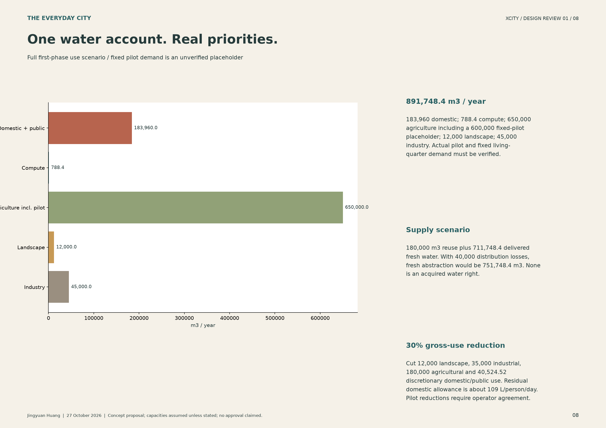

## 5. Human and machine

Pedestrian court interiors connect to transverse walks, neighbourhood connectors and the civic spine. Low-speed shared access loops support emergency response and residents needing vehicle access. Production, utility and farm deliveries remain on perimeter service loops. Every same-level geometric intersection between public walks and shared/machine lines is registered; the current count is 33. This is a conflict inventory, not a safety score. [geometry/movement.geojson]

At crossings, machines stop for people and uncertain perception triggers a stop, not an inferred right of way. Crossing control requires visible waiting space, low kerbs, physical stop control and manual release. The 10 km/h shared-loop target requires risk assessment. Charging, storage, loading and repair stay at service edges. Public access does not require a phone, facial recognition or a resident employment badge. [A-OPERATIONS]

The own geometry audit checks that pedestrian lines do not run through solid building footprints. Vehicle turning radii, actual doors, crossing visibility, dropped kerbs and accessible longitudinal gradients require the next design iteration. Regional corridor endpoints are research-grid points, not engineered intersections.

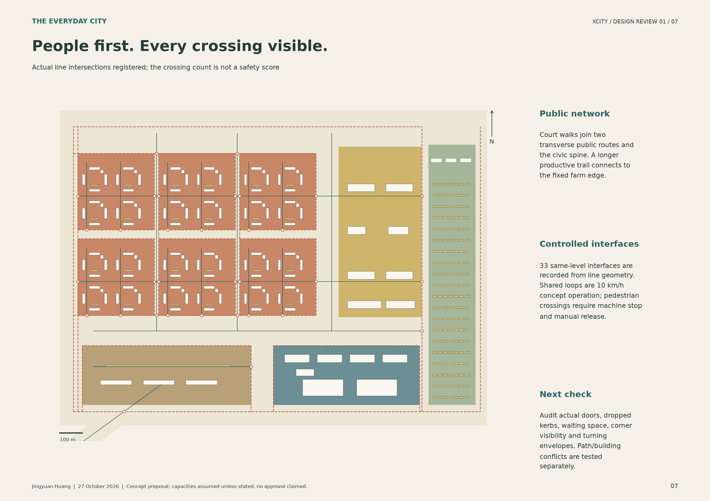

## 6. Programme and production

Six neighbourhoods each contain 240 homes. Each neighbourhood has four courts, each court four three-storey 48 x 12 m residential wings, each wing 15 dwellings. This gives 96 wings and 1,440 homes. At 2.5 people per home, the scenario contains 3,600 residents. Private and shared tenure, protected rental and accessible housing must be tested against real demand and affordability; the 25% protected-rental target is a policy proposal. [A-HOMES]

The six job groups are care/education 300, farm/food 300, repair 220, energy/compute 180, retail/culture 250 and utilities/logistics/administration 250, summing to 1,500. Of these, 1,350 are held by residents and 150 by incoming specialists. The mutually exclusive resident groups are 1,350 local workers, 200 remote workers, 1,000 students/children, 500 retired adults and 550 carers/jobseekers. Household transfers, pensions and remote income support non-local employment; targets are not confirmed recruitment.

The student scenario distinguishes 600 school-age pupils, 120 preschool children and 280 tertiary students/apprentices. Planned school places are 360 primary and 240 secondary, plus 120 childcare places. Actual age structure, teacher staffing, food, healthcare and operating budgets must be confirmed before occupancy. Eight health consultation rooms are a declared allowance, not a licensed medical capacity.

A proposed Everyday Skills Cooperative would organise paid repair, solar, water, food-safety, care and machine-supervision placements. It would seek professional education providers; no partnership or accreditation is claimed. Staff housing remains independent of a compute contract. A specific provider and funded training agreement are required before recruitment.

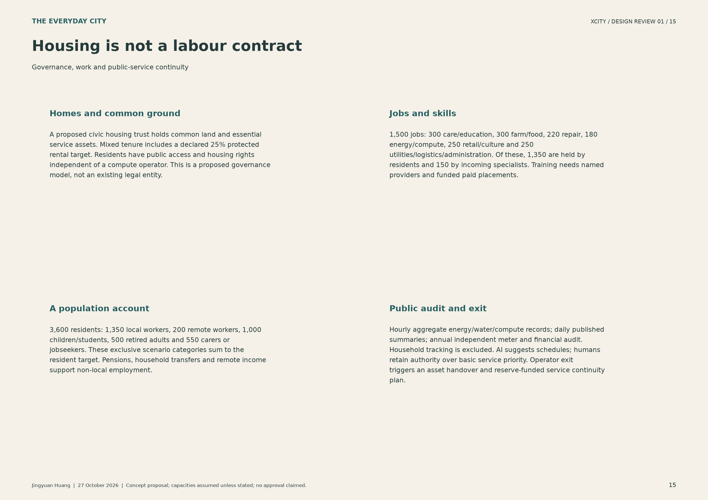

## 7. Urban form

The whole-site structure proposes one primary city, two later service towns and a separately managed energy/compute backbone, with a later eastern freight gateway. The fixed pilots anchor production and living context. Farming research and dry landscape retain their roles beyond the urban footprints. One first district of 3,600 residents and two conditional 1,800-person towns yield a 7,200-new-resident capacity scenario; later town layouts and resource budgets are not assumed complete. [A-GROWTH]

The first district’s geodesic research/construction envelope is 2.7722 km2, including a productive trail to the actual farm edge. Its core programme is 1.9 x 1.4 km. Geometry gives 274,546.7 m2 gross floor area, 5.394% building coverage and FAR 0.0990. The open-space category includes public commons, streets and dry margins, so its 42.63% share is not planted parkland. Lightweight shade roofs are excluded from solid-building area. [metrics.json]

Court units retain open corners and pedestrian interiors. Short independent wings at 9.9 m height frame common rooms and shaded sitting; services occupy mostly 3.3–6.6 m buildings. The section establishes a porch, shaded walk, dry commons, active route, emergency lane and a public-service edge. It is a conceptual spatial section rather than surveyed construction levels.

San Juan seismic risk favours regular short blocks, but structural joints, soil, foundations and fire separation require licensed design. Zonda response uses sheltered thresholds, maintainable filtered intakes and indoor refuge; local wind tests must determine whether edges block or worsen gusts. Full-cutoff 2200K lighting limits glare and upward spill. Dry mineral ground and limited irrigation avoid a decorative oasis. [A-TERRAIN; A-OPERATIONS]

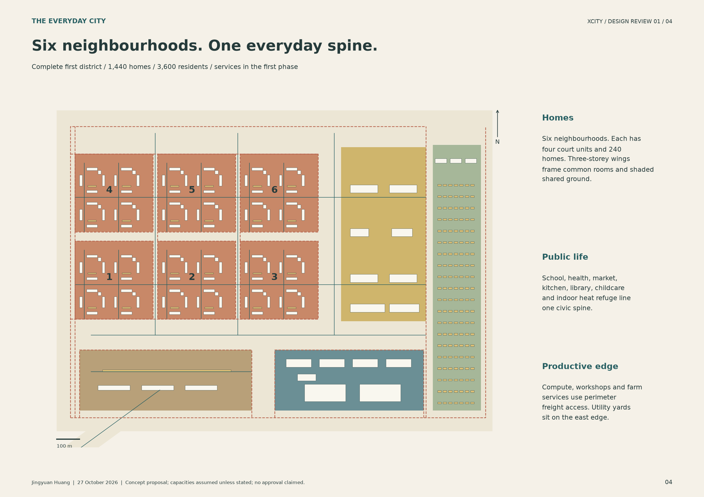
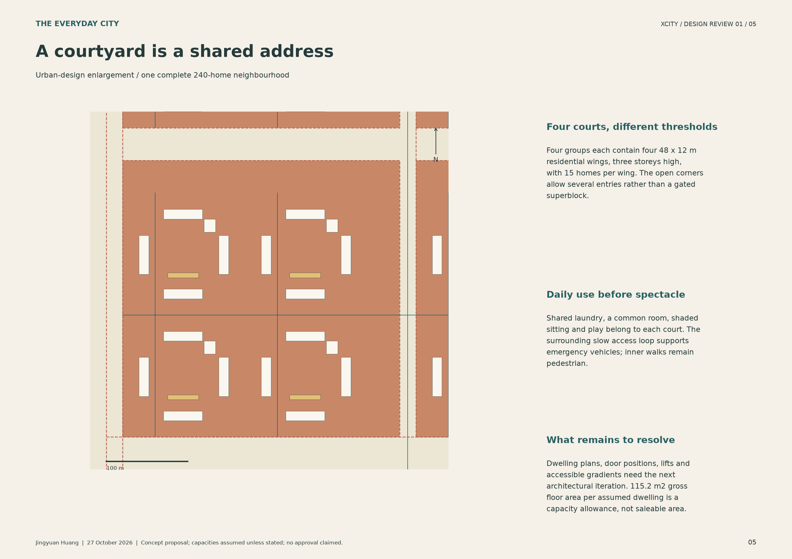
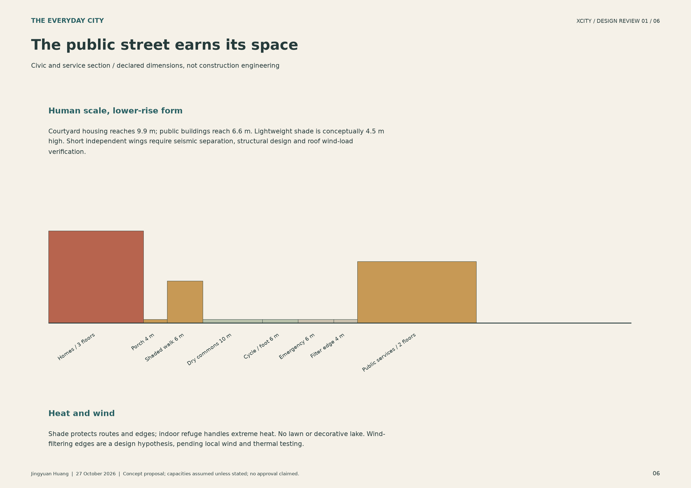

## 8. Governance and data

A proposed civic housing and infrastructure trust holds common ground, essential water/electricity assets, rights of passage and replaceable controls. Compute operators lease service capacity; they do not control whether a resident may remain housed. A resident and worker council participates alongside engineering and independent financial oversight. The trust, legal form, lease model and maintenance reserve are design proposals requiring legal and affordability work. [A-GOVERNANCE]

Publish hourly aggregate metered electricity, water, solar, storage and compute-load records, daily accessible summaries and monthly reconciled accounts. Independent engineers and accountants audit annually and after major failures. Household consumption, movements and faces do not enter public records. Small samples are suppressed, corrections remain traceable and paper/offline service remains available.

AI may suggest dispatch and maintenance. It cannot override basic water priority, pedestrian right of way, independent audit or growth approval. A meter failure suspends the corresponding clean-energy claim and expansion. Operator exit activates asset inspection, export/deletion of operator data, safe equipment removal and funded essential-service continuity. The reserve size must be based on actual budgets, not an invented guarantee.

## 9. Phasing

Phase zero verifies source boundaries, rights, small washes, soils, external access, power, water, sanitation and maintenance. The optional RN40 context line is a straight research hypothesis, not a constructed road or acquired right. On-site access, junctions, bridges or flood crossings, emergency travel and utility/communication connections are enabling works before occupancy. [SRC-OSM; context/external-access-study.geojson]

Phase one completes the six neighbourhoods, public services, farm interface, repair capacity, compute edge, water treatment, waste handling, basic power and emergency access together. A labelled utility/service yard accommodates treatment, storage, segregated waste and equipment; exact treatment units and capacities need engineering. Food/green waste can be separately composted only if quality permits; hazardous and electronic waste uses licensed transfer. Communications need two independent-path scenarios but no existing fibre is asserted.

Phase two opens the energy backbone and northern service town only after twelve months of audited reliable resource margin at least 20% above contracted demand, 80% occupancy, funded school/health/maintenance and safe access. Phase three opens eastern settlement and gateway only with binding freight demand, verified routes and hydraulic conditions, resource capacity and funded local services. The eastern shared reserve may be smaller than the indicative seven-square-kilometre intention after suitability clipping; it cannot be enlarged into unknown hazard land to meet a slogan.

Three hard-to-reverse first decisions are the civic land/service ownership structure, separating production service access from school/court interiors, and investing in safe external enabling infrastructure. They carry legal, distance and capital costs. These costs are accepted to allow useful city life if later growth or a compute tenant fails.

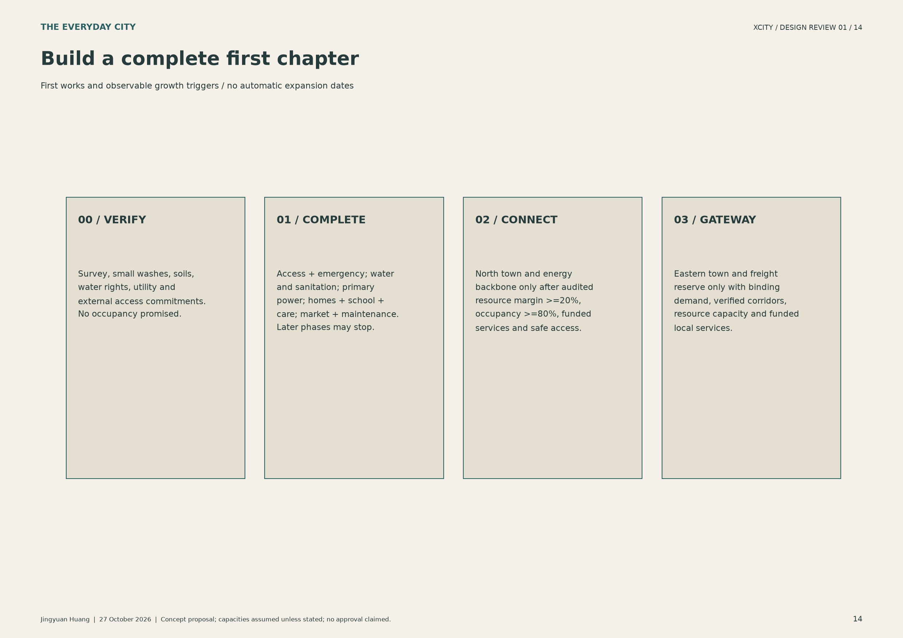

## 10. Key nodes

The shared locator places all three nodes in the first district and its actual productive connection. A01 belongs to the western neighbourhood; B03 to the southern production loop; C02 includes the southwest service frontage and trail to the fixed farm edge. These are three related urban places, not unrelated render locations.

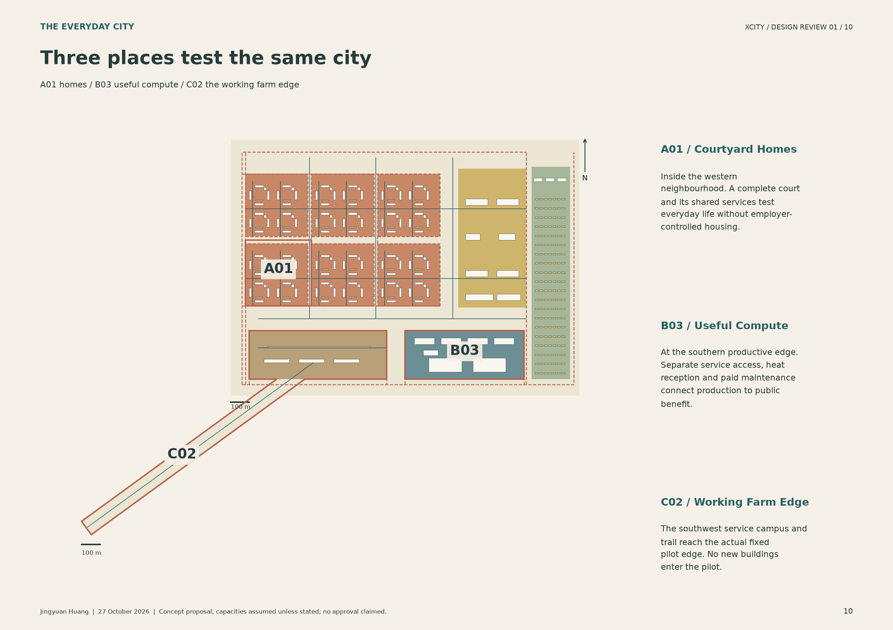

### A01 · Courtyard Homes
Four open-corner courts, shared laundry/common rooms, mineral play ground, small shade roofs and perimeter slow access form one 240-home neighbourhood. Daily use includes children’s school trips, care, laundry, shared meals and quiet evenings. Heat and dust alerts move activities into accessible indoor common rooms. The next architectural step resolves real household plans, lift access, doors, privacy and fire/seismic design. Housing is not conditional on employment.

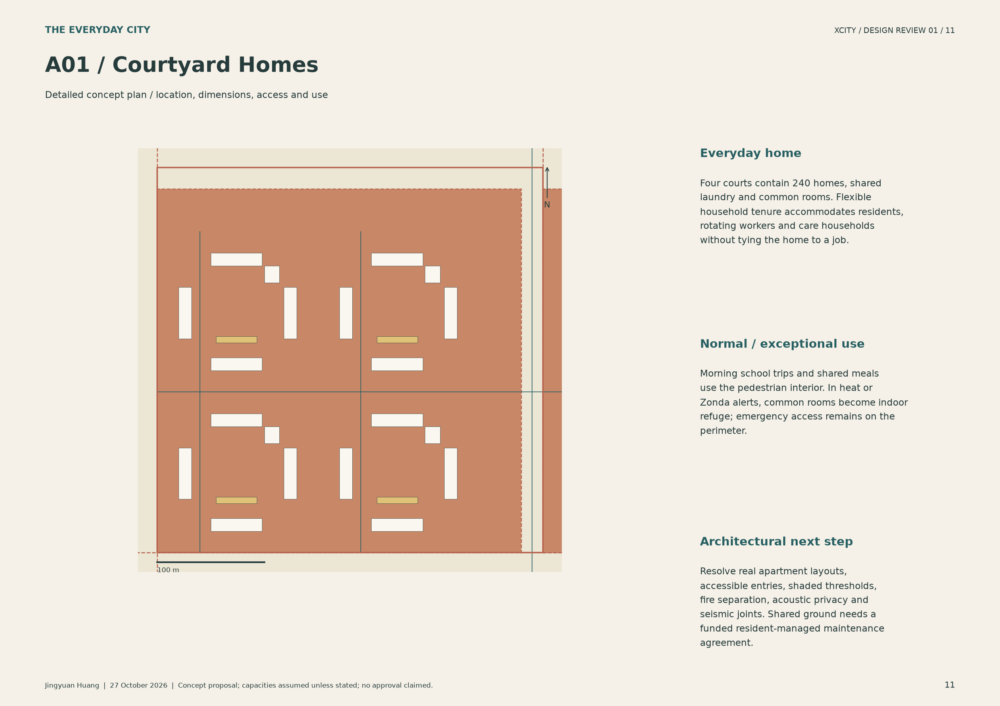
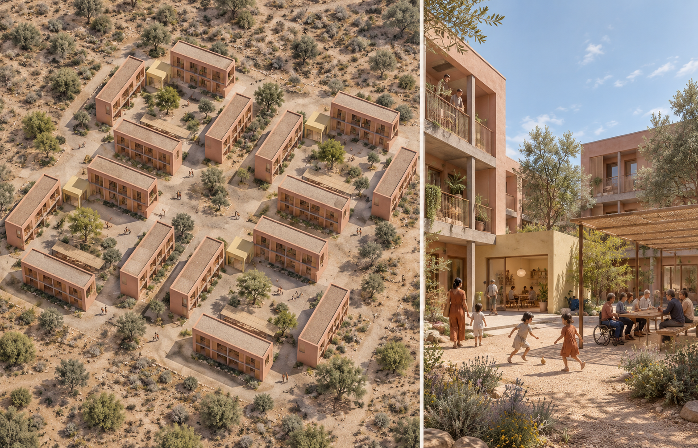

### B03 · Useful Compute
Two 180 x 75 m halls, four 110 x 35 m cooperative workshops and an 80 x 30 m heat-reception building establish a named thermal relationship. Freight and maintenance use their own loop; public learning remains on a managed boundary. Normal work, high-heat reduction, failed heat reception and operator exit have distinct responses. A meter and contract, rather than an arrow, establish useful heat delivery.

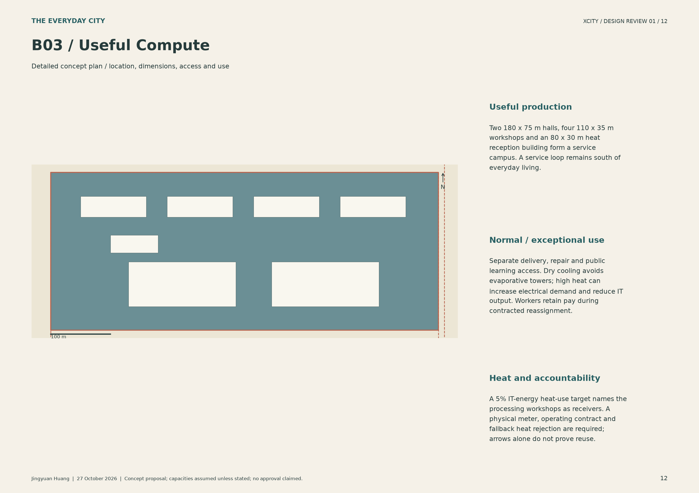
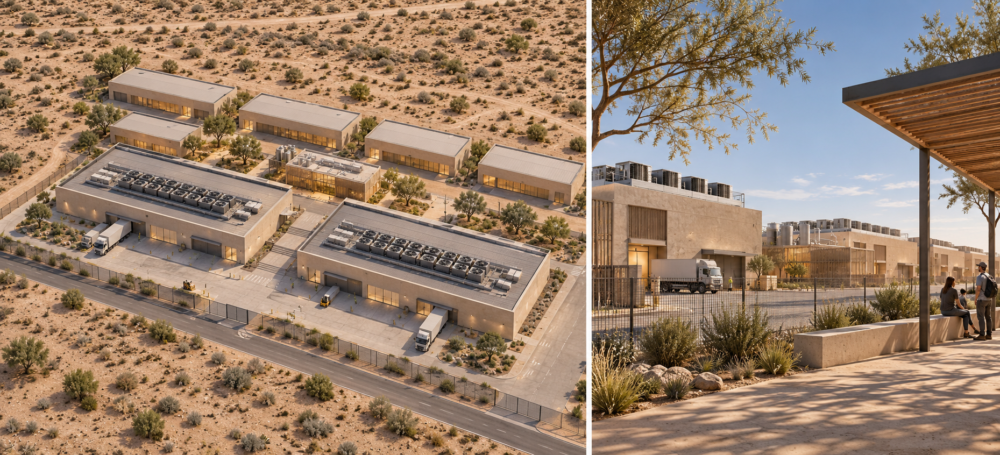

### C02 · Working Farm Edge
Three 140 x 20 m training/service bars and a 560 x 8 m shade roof form a public productive frontage. A trail reaches the actual fixed pilot edge; the image does not invent panels directly beside the city. Rear logistics and managed viewing gates let farm work continue without public wandering through arrays. The path closes in dust/storm alerts; wash crossings and accessible gradients must be surveyed. No tall crops or new buildings enter the protected pilot.

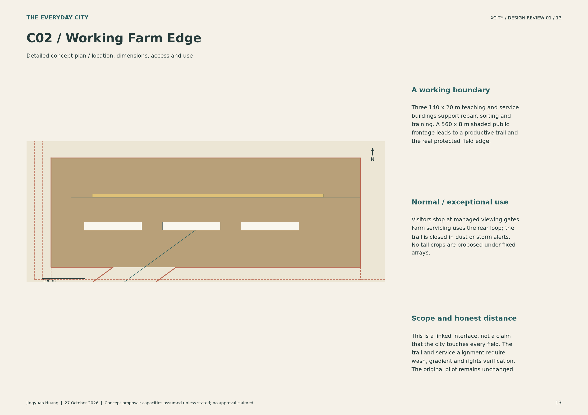
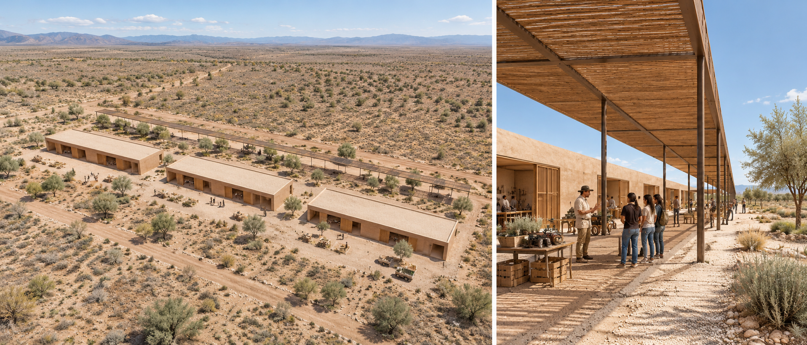

## 11. Metrics

All land quantities below are geodesic sums of current submitted structure, with one exclusive dominant structural role per area. Productive reserves are not irrigated hectares or installed energy. Local housing/jobs and utility figures apply to phase one; future 7,200-resident capacity is separate. The existing living-quarter population is unknown and excluded.

| Structural role | km2 |
|---|---:|
| agri production | 674.319 |
| living | 15.874 |
| energy compute | 56.869 |
| port | 4.750 |
| reserve | 904.874 |

The seven geometry files contain the full-site structure, phase-one envelope, complete land partition, buildings, movement, phase reservations and three node boundaries. Source calculations are reproducible from the included scripts. The regional route file and optional external study remain distinguished from engineered roads.

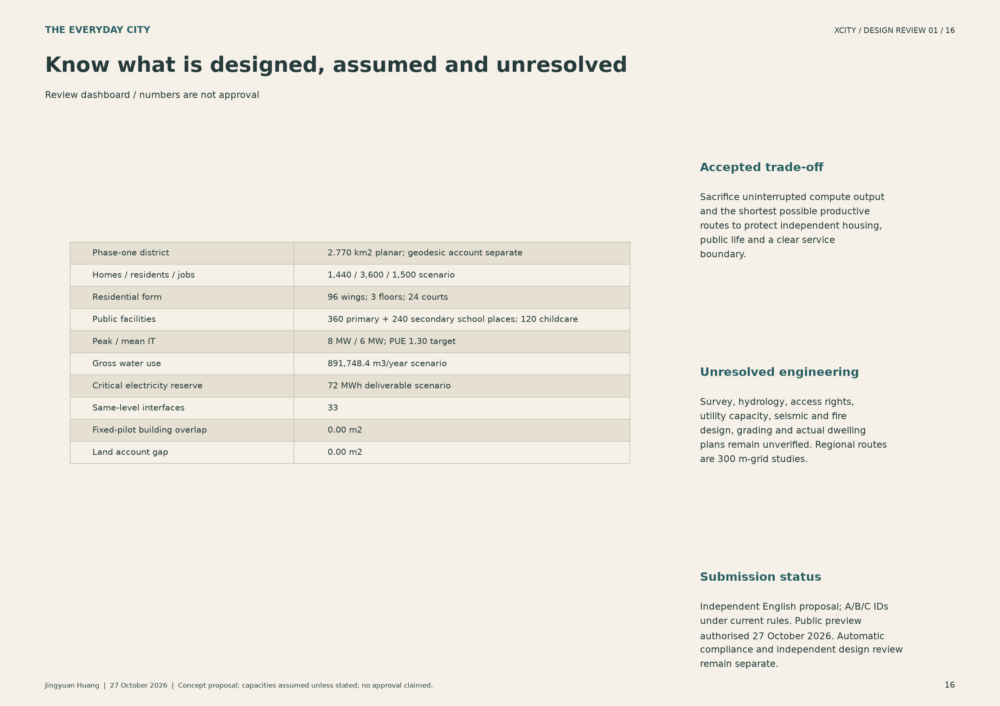

## 12. Risk and verification

The largest risk is committing housing before reliable rights and services exist. Legal water, actual fixed-pilot demand, electricity, external access, sanitation, emergency response and maintenance budgets are stop conditions. Site surveys can change grading, trail alignment, court access and therefore housing capacity; disclosed uncertainty is not a reason to occupy an unsafe layout.

Second, the 300 m regional route grid and 60 m terrain do not establish junctions, bridge designs, gradients or fire-engine access. Crossings and route lines require detailed independent verification. No finished image establishes hydraulic safety or constructed conditions.

Third, affordability and institutional continuity can fail even when the geometry is coherent. The civic trust, protected rental target, paid training, operator lease and reserve must become real governed agreements. A shared court without an accountable maintenance budget can become a burden.

This review still requires actual apartment layouts and accessible grading, service capacity/staffing, land and utility rights and engineering of later towns. These are explicit entrant-design, organiser-data and professional-verification gaps in the depth matrix. Nothing is described as independent design approval.

## 13. Declared trade-off

The scheme does not maximise uninterrupted compute throughput or minimise every productive walking and freight distance. It accepts flexible IT output, a clear service boundary, additional common-ground maintenance and a longer connection to the actual farm edge. Compute investors and operators bear interruption through contracts; housing and essential public services require separate continuity funding.

The six-neighbourhood form favours shared public life and identifiable courts over a single monumental object. It also accepts that the regional city remains conditional rather than filling every dry hectare with promised development. The trade-off must be tested against real affordability and resource contracts; it is not automatically virtuous because it is described.

## 14. Sources, autonomy and status

The source snapshot is XCITY main at 9e504de, boundary revision 2026-10-27-seam-closure. Source checksums and the limitations of Copernicus terrain, DEM channels, OSM roads and owner-derived boundaries are recorded in sources.json. No other entry’s city geometry, prose or images are copied. The old published scheme is unchanged.

Jingyuan Huang asked for an independent new proposal prioritising housing and public life, delegated the node selection, required English final public material and A/B/C node identifiers without old aliases. Codex authored the geometry, calculations, drawings and text on macOS; the model is GPT-6 family and exact serving version is unavailable. Generated imagery is conceptual and its prompt/control provenance is registered.

The organiser adopted A/B/C identifiers and English public submissions in acb3cf8. This package uses A01, B03 and C02 without aliases. After reviewing the completed concept, the human explicitly authorised pushing it and showing it on the homepage on 27 October 2026. Automatic checks and independent design-content review remain separate; public preview is not official entry acceptance or design approval.