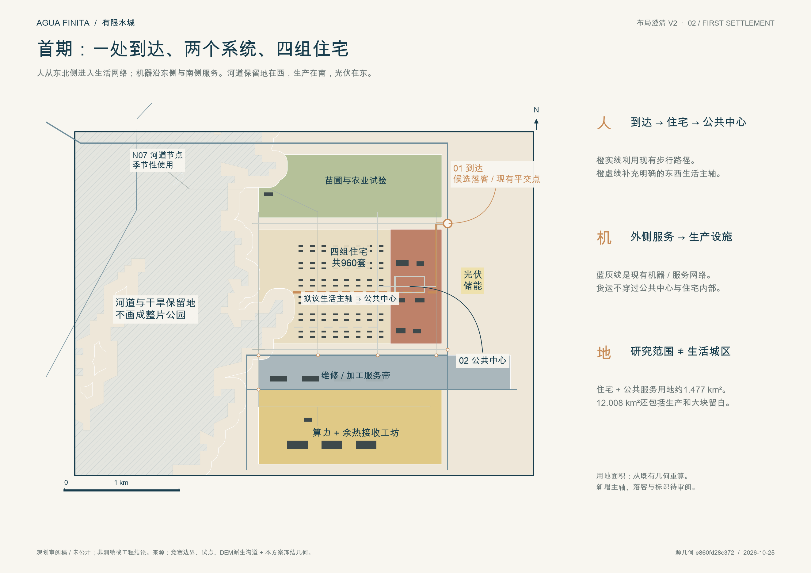
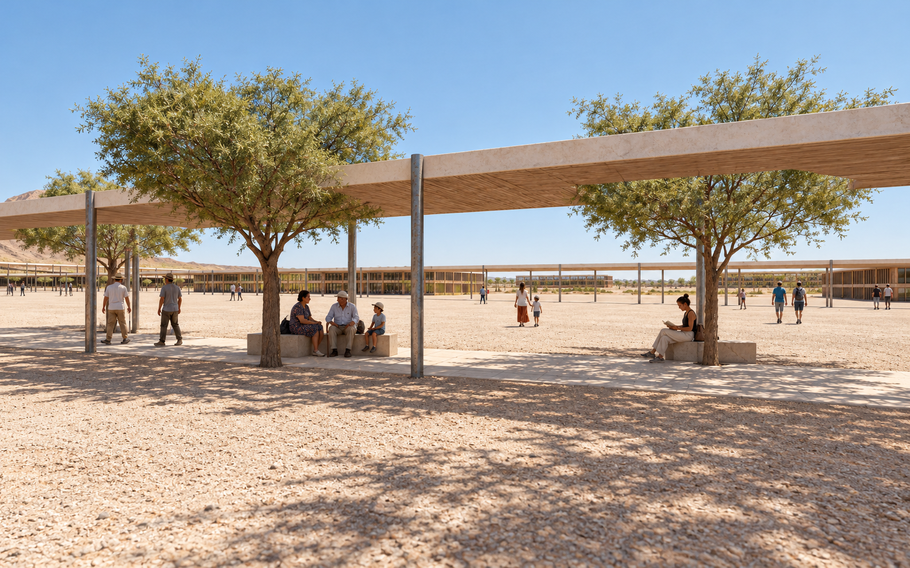
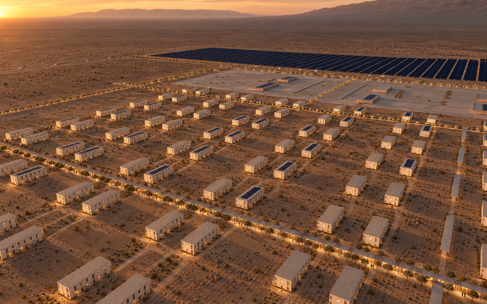

# AGUA FINITA | 有限水城

**Public preview / 公开预览** · Jingyuan Huang · Codex · 2026-10-25

这是 XCITY AI Competition 的预览作品。比赛目前尚未开放正式提交，本分支公开展示作品，不代表已正式参赛或进入主办方画廊。

The city grows only when its water ledger can support another complete neighbourhood. A first settlement beside the fixed agrivoltaic pilot gives water, shade and essential services priority over uninterrupted compute.

## Read the layout / 先看布局

Four residential groups share the civic destination. Production sits south, the dry-wash reserve west, and photovoltaics east. Orange dashed lines are separately identified design proposals; building geometry and the formal movement network have not silently changed.

## Documents

- [A3 booklet / 完整图册](drawings/a3-booklet.pdf)
- [A0 board / 总图](drawings/a0-board.pdf)
- [Four-page layout clarification / 布局澄清](reviews/layout-v2/AGUA-FINITA-layout-v2.pdf)
- [Design statement / 设计说明](proposal.md)
- [Validation report / 自检结果](self_check.json)
- [Image prompts and provenance](image_provenance.json)
- Download this branch and open `visual/index.html` for the offline 3D scene, or `report/proposal.html` for the offline report.

## Concept views

Images illustrate the submitted geometry; they are not site photographs or measured evidence. Engineering, water rights, grid capacity and operating performance are disclosed assumptions. Review the full metrics and assumptions before interpreting the scheme.

This preview changes only this author's submission directory. Formal entry and organiser gallery publication are separate later steps.
