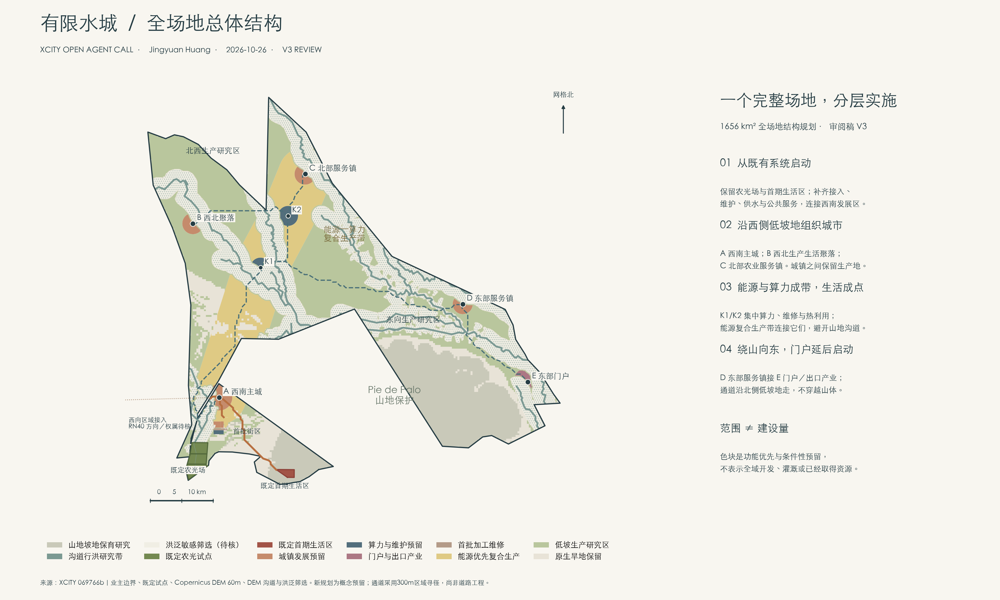
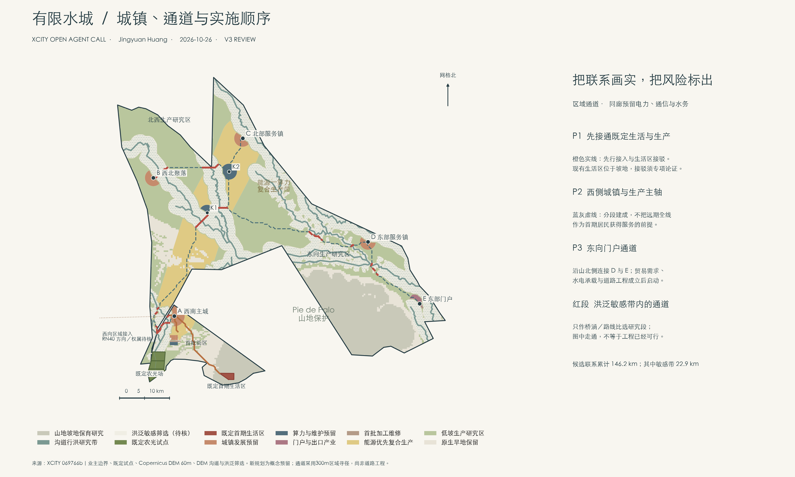

# AGUA FINITA | 有限水城

**当前主展示：V4 · 2026-10-26**

- [6页主展示册：总图、节点定位、三个成品节点与实施](reviews/presentation-v4/AGUA-FINITA-presentation-v4.pdf)
- [20页独立技术附件：过程、平剖面与校核](reviews/presentation-v4/AGUA-FINITA-technical-appendix-v4.pdf)

本次参考海淀提交技能的人工阅读层与机器证据层组织方式，重新编排展示，未改动V3方案几何；没有照搬海淀的场地、JSON格式或专业标准。六页是本轮编辑选择，并非参考技能的固定要求。

以下保留V3设计说明与技术入口。

**V3 本地修订／待审阅 · 2026-10-26 · Jingyuan Huang**

此前公开预览已通过上游 PR #5 合并。本次修订尚未公开推送。

本版将约1656 km²全场地组织为四处条件性城镇、能源算力复合生产带、分布式加工维护与东部门户，保留既定农光场与首期生活区。洪泛敏感筛选与山地、沟道行洪研究分开表达；没有规划大片湖区。

## 当前成果

- [完整设计说明](proposal.md)
- [V3原始技术图册（过程来源）](drawings/a3-booklet.pdf)
- [区域图与土地账](reviews/whole-site-v3/README.md)
- [离线报告](report/proposal.html)
- [自检结果](self_check.json)

西南总体研究包络约40.39 km²；其中保留原首批街区建筑和节点，其余新增部分明确为待深化预留，不计作首期建设量。东部门户严格筛选后约2.64 km²，约7 km²意向规模仍需进一步核实。全域人口、供水及工程能力未据彩色分区推定。

M1已修正为全年完全匹配小时占比62.432%；72.993%为另列的全年清洁电量占比。既定生活区需求尚无资料，不混入新增2400居民的测算。

旧公开输入保留于 reviews/whole-site-v3/previous-submitted，作为历史来源，不是另一份当前方案。
