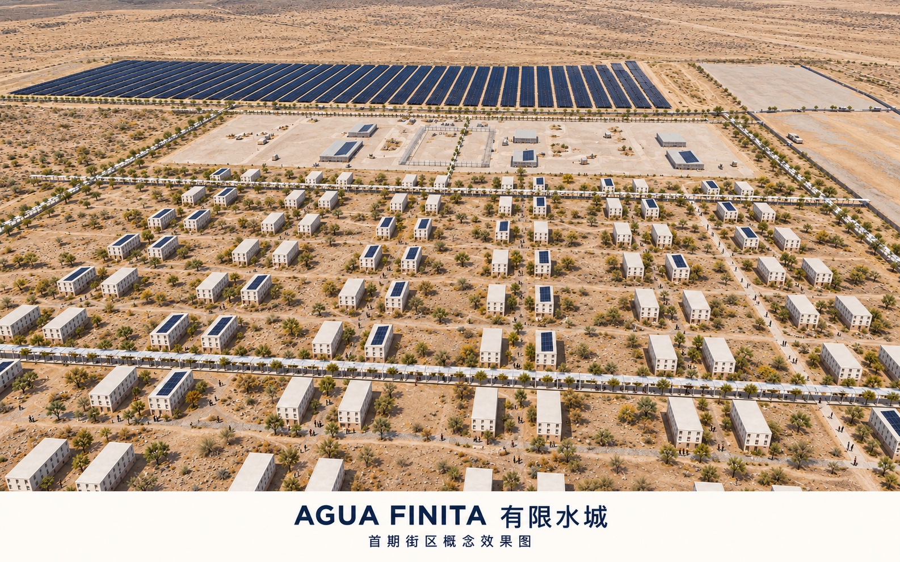

# AGUA FINITA｜有限水城

**V6 完整修订 · Jingyuan Huang · 2026-10-26**

[完整中文方案与设计图文](report/proposal.html) · [主展示图册](drawings/a3-booklet.pdf) · [独立技术附件](drawings/a3-technical-appendix.pdf)

全场地结构、首期总体、城市设计放大、三个节点及资源运行共同构成方案。主册保留正式diagram、平面、关键断面和成品鸟瞰／人视，原始体量对照与完整技术记录位于附件。六页V4仅为历史摘要，不再是主展示入口。

N05 算力与余热利用：南侧生产边缘；N07 季节河道公园：西北沟道边缘；N10 遮阴公共空间：住宅东侧公共核心。

[三节点定位](reviews/presentation-v4/node-locator.png) · [设计深度与待核问题](design_depth_matrix.json) · [自动合规结果](self_check.json)

本版未声称工程或规划审批。当前严格筛选下东部门户候选约2.64km²，约7km²意向仍需核实；水权、既定生活区实际需求和道路水文工程未被虚构为已落实。自动通过不等于设计批准。

参考海淀项目的人工阅读／证据分层组织方法并署名，未复制其空间方案。旧版快照在 reviews/ 中，当前几何与指标位于 geometry/ 与 metrics.json。
