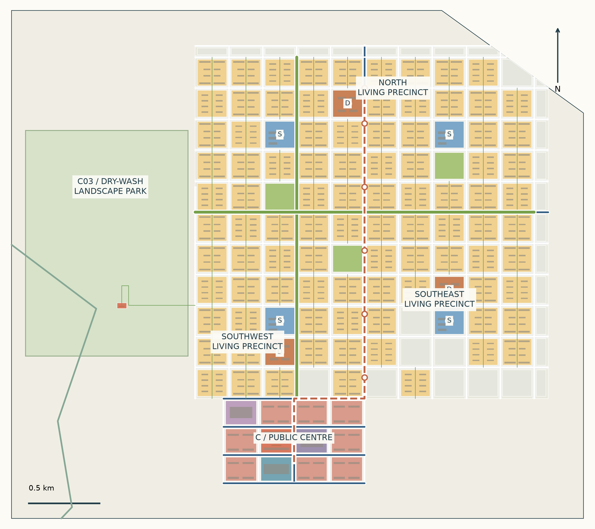

# AGUA FINITA / V12 public working revision

V12 working design preview. This revision updates the whole-territory energy landscape, compact hall layout and agrivoltaic operating drawings. Future fields are resource-gated proposals, not installed capacity. Generated production images with incorrect hall counts were rejected.

### 1. Whole-site energy landscape

The issued boundary, source seasonal channels, regional links and resource-gated future fields are shown together. New footprints in Z3/Z4 are a long-term planning opportunity. They do not establish installed generation, irrigation rights, crop yield or grid capacity.

### 2. Fields follow the ground

Source channels interrupt the field pattern. Pilot interiors stay protected. Slopes and study buffers are declared assumptions, not legal setbacks. Agricultural research, gateway functions and mountain stewardship retain separate roles.

### 3. Compact compute halls

Eight existing 96 x 48 m hall footprints retain their declared 2 / 4 / 8 MW IT scenario. Shared plant plots and shorter service loops replace unexplained internal gaps. The worker shuttle follows the solar edge rather than crossing arrays. Equipment, road engineering and resource verification remain open.

### 4. Construction, not dates alone

Two halls operate first, then two more, then the second row of four. Access and shared utilities precede IT operation. Future construction must remain isolated from commissioned halls.

### 5. Panel, crop and working geometry

The proposed-extension prototype combines forage and jojoba with elevated panel rows, working lanes, headlands and zoned irrigation. It does not redesign the fixed pilot. Dimensions and pruning envelopes are declared assumptions awaiting equipment and agronomy verification.

### 6. A section that can be checked

Compare panel and plant envelopes with the working space. Drought tolerance does not establish zero irrigation demand. Detailed structural, electrical, agronomic and water verification remains outstanding.

## Retained programme and full design statement

## 1. Design thesis

Housing forms continuous precincts with daily services. A compact town centre supports shared public life. Computing, repair and utilities occupy a separate productive estate; proximity alone is not a benefit.

## 2. Full-site zoning

Six proposed regions cover the issued boundary: Z1 southwest urban/services; Z2 northwest agricultural research; Z3 northern energy research; Z4 central production/transfer; Z5 eastern gateway/logistics; Z6 southeast mountain stewardship. Gross regions are not construction land. Fixed pilot outlines remain unchanged. Base zoning and overlapping system context are separate accounts.

## 3. Regional movement

Primary and secondary corridor studies connect the southwest, northern service hub, conditional transfer sites and eastern gateway. Arrival and freight approaches remain unacquired studies. Terrain, channel crossings, rights and emergency operation require specialist design.

## 4. Complete urban layout

All three construction phases share continuous R precincts and C town centre. Designed full-build-out capacity is 10,240 dwellings and a 25,600 resident scenario at 2.5 people per dwelling; release is conditional on demand and resources. The separate P/S system is not moved beside housing to compose an image.

## 5. Streets and public transport

Primary/secondary distributors, local streets, a proposed passenger spine, public anchors and court routes are shown distinctly. The productive worker path parallels the service spine; yard-spur crossing control remains a design hold-point.

## 6. Landscape and shade

Dry parks, a source seasonal wash and proposed walking/engineered-shade links form the landscape diagram. Green symbols are not evidence of irrigated forest, lawns or permanent water. Targeted planting requires a verified reuse allocation.

## 7. Public space and services

Four education plots and phased daily-service anchors support the living district. The assumed full-build-out education need is 3,840 places and the design provides 4,320 places. Block-gate network walking tests do not establish safe door-to-door access.

## 8. A03 market commons

Public space in heat and Zonda wind is tested at the town centre: two long market/refuge halls, an 80 x 80 m commons and two open shade bands. Aerial and eye-level images share registered source cameras.

## 9. B03 compute and repair

Eight staged compute halls and four repair workshops occupy their own productive estate. IT expands through 2, 4 and 8 MW scenarios only after resource and demand gates. No unverified residential heat network is credited.

## 10. C03 seasonal wash edge

Dry-season visitor access uses an edge path and a removable shade point. Access closes on warnings. The image is a local visitor-edge crop of the larger seasonal-wash study, not a lake or a surveyed flood design.

## 11. Construction phases

Phase 1 independently operates housing, essential services and production. Phase 2 extends connected precincts only with demand and audited resource headroom. Phase 3 completes northern housing and activates the gateway only after its independent access, trade, utility and worker-welfare case.

## 12. Resources and livelihoods

The new Phase 1 programme has a declared fresh requirement of 409,590 m3/year. Fixed-pilot and existing living-quarter demand remain additional and unverified. Employment figures describe programme capacity, not contracted jobs or a demonstrated household income base.

## 13. Presentation and trade-off

The A0 uses spatial diagrams and concise phase cards, with no spreadsheet-style account. Detailed figures remain in the booklet and technical records. The scheme gives up maximum uninterrupted IT throughput and the shortest productive route to protect continuous public life and honest resource limits.

## 14. Review and disclosure

Jingyuan Huang authorised this public preview. Codex created the geometry, calculations, diagrams and layout; built-in image_gen.imagegen finished the selected source-controlled images, with exact model version unavailable. Images illustrate design, not measurements or approval. Original controls, prompts, cameras and rejected trials remain traceable. Automatic gates and independent design assessment are distinct; this draft is not submitted as approved.

### Retained city diagrams

V11 city and public-node studies remain under review; V12 supersedes the production arrangement.

