# AGUA FINITA | The Finite Water City

Water, electricity and public services that can actually be delivered determine how this city grows. Jingyuan Huang / jingyuanhuang-design. Full V6 revision of 26 October 2026; English presentation and current node identifiers updated on 27 October 2026. Independent design-content review remains outstanding. This continues the existing published entry rather than creating another proposal. All finished images are concept illustrations.

## 1. Position

Agua Finita must first be a place where ordinary life works. Housing opens alongside a school, clinic, daily shops, public kitchen, repair jobs and places to meet in shade, beside actual dryland, energy production and agriculture. Compute contracts can be interrupted; essential services must not disappear when an operator's business changes. Expansion requires demonstrable water, power, access and maintenance.

The proposal uses distributed towns and productive corridors rather than continuous building across approximately 1,656 km². A is the southwest principal-town study location; B a northwest production/living settlement; C a northern agricultural service town; D an eastern service town. K1 and K2 reserve compute, energy and maintenance clusters. E reserves a shared gateway/export-industry location. Three nodes in the southwest first district test production's contribution to the city, retreat from floods and public life in heat. These are design reservations, not surveyed population or proven demand. [SRC-KML; A-V3]

AGUA FINITA uses dark blue for public-resource accountability, earth colours for production and olive-grey for dryland and seasonal channels. A recognisable district aerial replaces an abstract slogan as the cover. Signage, physical public accounts and services accessible without a smartphone use consistent names. Identity follows observable operating rules, not invented accounts of local preferences.

## 2. Site reading

The current organiser boundary closes internal seams without expanding the combined exterior. The submitted structure totals approximately 1,656.69 km² geodesically. The boundary revision record and GeoJSON establish the competition extent, not cadastral certification. The fixed agrivoltaic fields occupy approximately 13.9 km²; the separate fixed first living-quarter outline occupies approximately 2.48 km² to the south. New housing is not counted as that fixed quarter, and proximity does not establish access between the two places. [SRC-KML; SRC-PILOT]

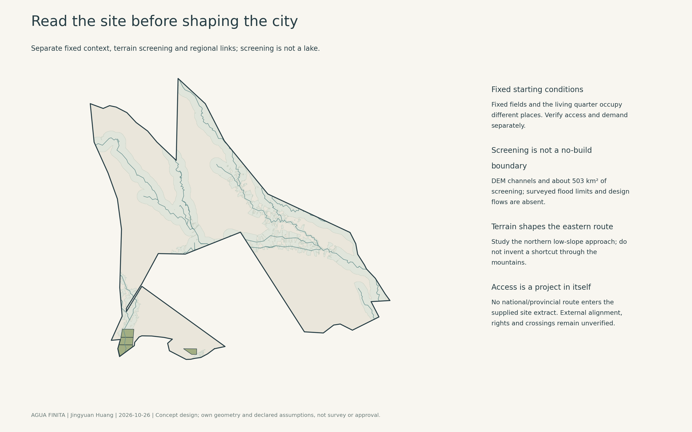

The fixed under-panel arrangement of jojoba, rosemary, forage cactus and grazing remains unchanged. Tall or climbing crops do not enter existing arrays. The new district offers maintenance, limited processing and daily services; roads, utilities and operations must make these connections real.

DEM-derived seasonal channel lines omit some small washes. Approximately 503 km² of flood-sensitive screening derives from channel proximity and relative elevation; it is not a lake, surveyed flood boundary or blanket permanent prohibition. Mountains/slopes, channel-conveyance studies and wider screening are shown separately. Regional slope ≥5%, elevation ≥850 m and a 150 m study distance on either channel side are conservative assumptions. Initial permanent buildings continue to avoid the sensitivity band plus 30 m and channels plus 150 m. None of these assumptions certifies flood safety. [SRC-DEM; A-FLOOD; A-V3]

A southwest start is close to fixed production and can support a complete initial living/maintenance cluster. West-central land supports conditional production expansion; the eastern gateway remains later, rather than replacing the first city with an export park. Study an eastern connection around the northern low slopes, not an invented mountain shortcut. The approximately 27.6 km RN40 distance is the nearest distance from the entire boundary, not this scheme's engineered road length. External alignment, rights, crossings and funding are pre-occupancy conditions. [SRC-OSM; A-ACCESS]

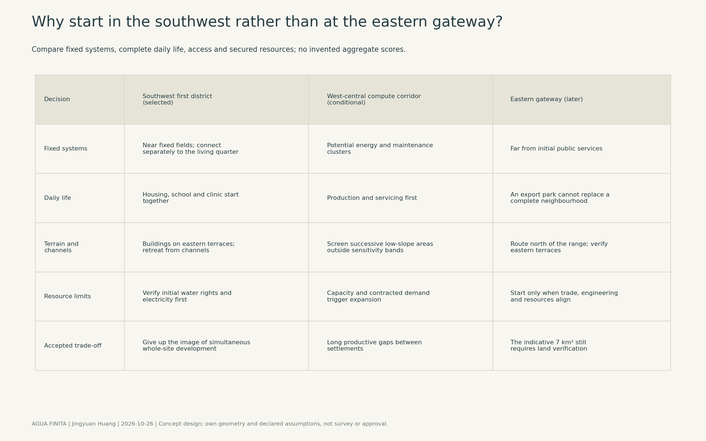

## 3. Energy and compute

Assume initial peak IT load of 12 MW: 12 MW by day and 6 MW at night, averaging 9 MW and 78,840 MWh/year. PUE 1.25 and WUE 0.02 L/kWh are procurement/operation targets, not supplier guarantees. Closed-loop chip cooling uses dry heat rejection with necessary mechanical air-cooling correction, without an evaporative cooling tower. Dry rejection accepts hot-hour electricity and curtailment costs, borne by compute contracts. [A-COOL]

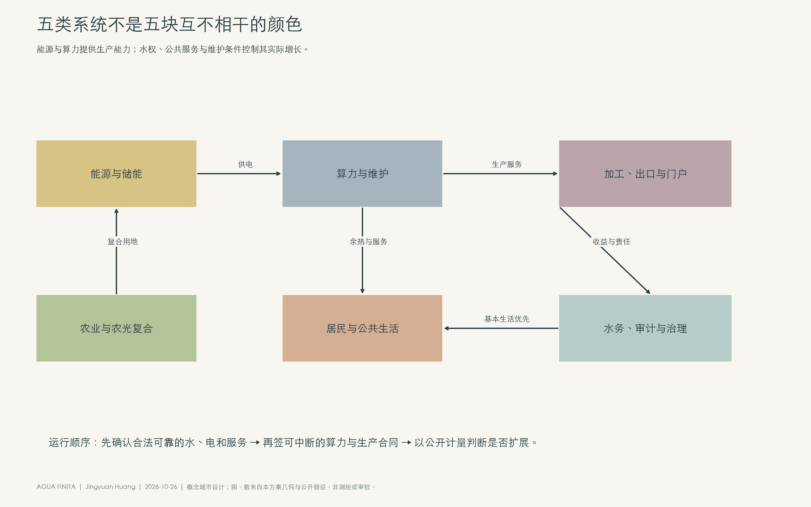

Assume 40 MW PV, 480 MWh battery storage and 75 MW conversion capacity, with 30 MW grid connection and no electricity exports. Protect 216 MWh of deliverable emergency storage: about 72 hours at a 3 MW critical load. This is not proof of uninterrupted annual production. Synthetic solar output, seasonality and periodic dust events must be replaced by actual weather, grid and equipment evidence. [A-ENERGY]

M1 counts the share of 8,760 hours whose entire load is matched by concurrent carbon-free supply: 62.432% in the current scenario. The separate clean-energy quantity share is 72.993%. Storage starts at its protected reserve, without crediting unexplained initial battery energy as clean supply. Unverified grid imports receive no clean credit. Annual imports are approximately 31,346.71 MWh and peak imports 17 MW in this scenario only. [A-ENERGY; tools/hourly_dispatch.csv]

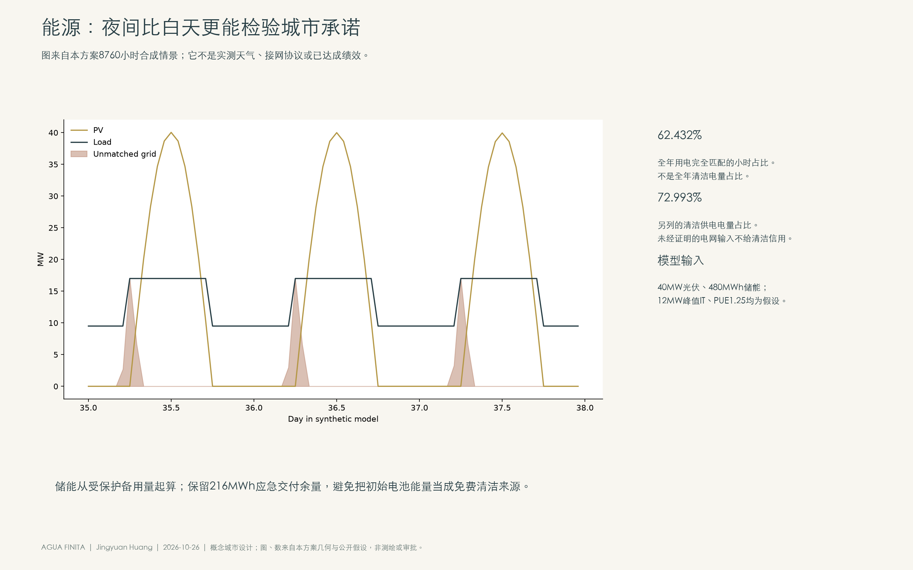

Waste heat has a named proposed receiver: the initial cooperative drying workshop and process preheating target 3,942 MWh/year, 5% of annual IT electricity. A 70 × 35 m receiving pavilion, repair/processing strip and compute halls are modelled together. Heat-pump uplift, pipe losses, crop-process temperatures and operating-time matches remain unverified. Without a real receiving contract, heat cannot simply disappear from the ledger. Regional K1/K2 reserves are outside the first 12 MW commitment. [A-HEAT]

## 4. Water

Initial gross annual use is 1,000,000 m³, including a fixed-agriculture allowance and new-district uses. Assume 840,000 m³ external fresh input, less 40,000 m³ distribution losses: 800,000 reaches users, supplemented by 200,000 m³ treated internal reuse. Reuse is not another external water right; these figures do not establish 1,040,000 m³ of new supply. [A-WATER; A-RETURN]

| Use | m³/year | Scope and basis |
|---|---:|---|
| Residents and civic life | 140,160 | 2,400 people × 160 L/person/day, including community facilities; assumed |
| Compute make-up | 1,576.8 | 78,840,000 kWh × 0.02 L/kWh; assumed target |
| Agriculture and cleaning | 778,263.2 | Fixed agriculture allowance 600,000; new irrigation 170,000; cleaning 8,263.2 |
| Landscape | 20,000 | Limited drip irrigation; no lawns or ornamental lakes |
| Industry | 60,000 | Processing/maintenance allowance, subject to process verification |
| Total | 1,000,000 | Initial-use account, not final whole-site demand |

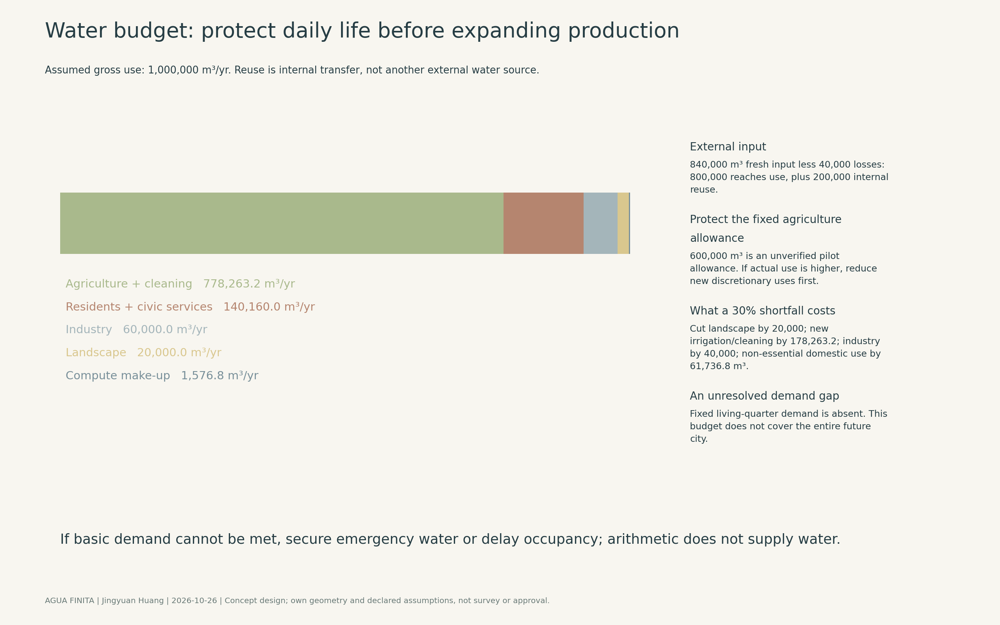

Study reuse from domestic returns of 100,000, industrial returns of 50,000 and collectable agricultural drainage of 50,000 m³/year. After treatment, allocate 180,000 to agriculture and 20,000 to landscape. Verify treatment grades, salts, hygiene, discharge and concentrate disposal. Stormwater and atmospheric condensation are not guaranteed supply. [A-RETURN]

A 30% gross-use shortfall requires reducing 1,000,000 to 700,000 m³: stop landscape's 20,000 first, new irrigation/cleaning's 178,263.2 next, cut industry by 40,000, then non-essential domestic/community use by 61,736.8. Retain fixed agriculture's 600,000 and compute make-up's 1,576.8. Domestic/community use remains 78,423.2 m³, approximately 89.52 L/person/day. Verify whether essential services can operate on this emergency scenario. Otherwise secure reliable emergency water or defer occupancy; do not deprive people to balance a spreadsheet. [A-SHORT]

Population and actual water demand in the fixed living quarter are not supplied and are not silently included in the additional 2,400 residents. The agriculture allowance is also not measured use. Higher verified fixed demand takes priority over new discretionary uses. Every expansion scenario must separately account for the fixed quarter and actual pilot demand.

## 5. Human and machine

Separate public walking routes from service-machine networks. Processing, loading, charging and storage stay at the service edge. Continuous housing/civic routes prioritise walking, wheelchairs and mobility aids. Seven at-grade interfaces are registered from drawn people/machine crossings. This count is not safety performance: new shuttle stops, shared loading or service entrances require renewed registration. [geometry/movement.geojson]

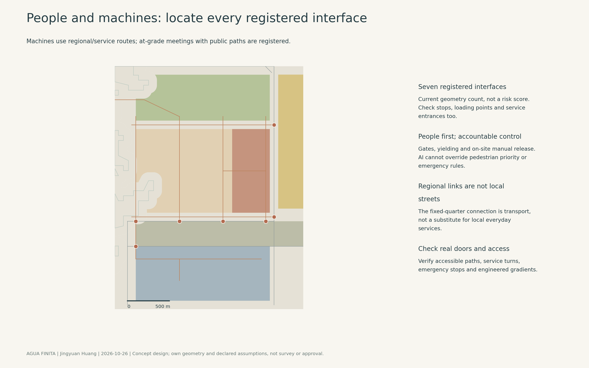

Interfaces use machine yielding, locked gates, waiting/refuge positions and manual release. Machines stop when sensing is uncertain; they do not infer right of way. Children, older people and users without smartphones have equal priority. Service speeds of 10 km/h, falling to 5 km/h near interfaces, are assumptions for risk assessment, not proof of zero accidents. Staff-managed transfer points at the service edge prevent delivery robots from taking over public paths.

Regional corridors are transport/utility studies, not continuously shaded pedestrian streets. The fixed-quarter connection does not replace that quarter's school, basic healthcare or daily services. Routes use a 300 m terrain grid; grid endpoints are not designed junctions. External alignment, grades, crossings, emergency access and real-door connections need engineering. [A-ACCESS; A-V3]

## 6. Programme and production

Model 96 three-storey residential bars, each with 10 homes: 960 homes at 2.5 people each yield 2,400 additional residents. A typical 42 × 16 m bar has approximately 2,016 m² over three floors; this is design capacity, not housing approval. Complete unit layouts, accessibility, lifts or alternatives, parking and actual doors remain to be designed. Propose 20% protected rental housing with public rent/eligibility rules, independent of employment by a single compute operator. [A-HOUSING]

| Employment group | Target jobs | Initial-city role |
|---|---:|---|
| Compute and energy operation | 180 | Power, storage, equipment and operations |
| Agriculture/pilot-related work | 300 | Fixed production and limited new trials |
| Repair and manufacturing | 180 | Solar, machine and processing maintenance |
| Education, health and care | 240 | Independent phase-one services |
| Retail, hospitality and culture | 180 | Everyday life and public activity |
| Water, logistics and administration | 120 | Infrastructure and city maintenance |
| Total | 1,200 | Staffing scenario, not confirmed recruitment |

Residents take 1,080 local jobs; outside specialists take 120. The 2,400 residents also include 120 remote workers, 600 children/students, 300 retired adults and 300 carers/jobseekers. These mutually exclusive roles reconcile to 2,400. Transfers, pensions and remote incomes support residents outside local jobs; a population difference does not justify invented employment. [A-HOUSING]

The proposed Agua Finita training cooperative organises paid apprenticeships in water quality, electrics, PV, machine maintenance, care, food safety and dispatch supervision. Seek collaboration with Universidad Nacional de San Juan and INTA without claiming signed partnerships. Future regional jobs need training, wages, demand and operating funds, not equal multipliers on town colours. [A-GROWTH]

Four conditional town reserves do not establish four times the initial population. A simplified gross-use sensitivity is “600,000 m³ fixed-pilot allowance + n × 400,000 m³ additional initial-district uses”, not n × 1,000,000 duplicating the same fixed agriculture, and never a water entitlement. Verify fixed living-quarter demand separately.

## 7. Urban form

The southwest detailed-study envelope covers 40.59 km² geodesically, shaped by the northern field edge, drainage screening, site edge, northern connections and retained initial blocks. It is no longer a convenient 4 × 3 km rectangle. Undeveloped portions are explicitly reserve, not completed block design or phase-one built area.

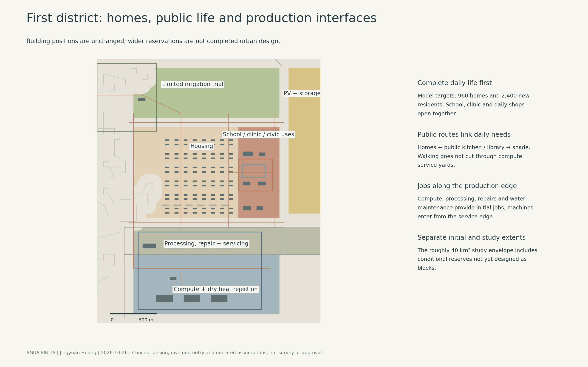

Housing is north of production. School, clinic, kitchen, library and shaded civic core lie east of housing; repair/processing and compute are south; PV/storage occupies the eastern edge; limited irrigation trials are north. The channel edge remains dry open space with a high-ground educational node. Daily entrances must connect, service traffic must avoid school/public gathering grounds, and initial services require independent maintenance.

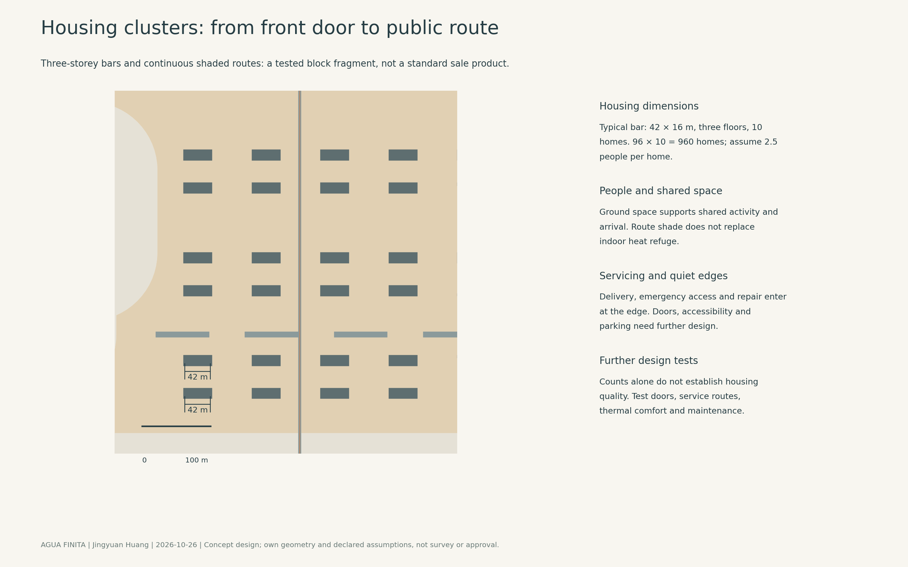

Forms are mainly one to three storeys: housing approximately 10.5 m, compute halls 9 m, repairs approximately 7 m, and light roofs approximately 4.5–5 m. Regular plans and lateral systems respond to San Juan's seismic context; replaceable light roofs do not resolve seismic joints, soil, drift, wind loads or fire. Local engineers must verify these, including the applicable version of INPRES-CIRSOC 103 Part I 2018 and amendments. [A-SEISMIC]

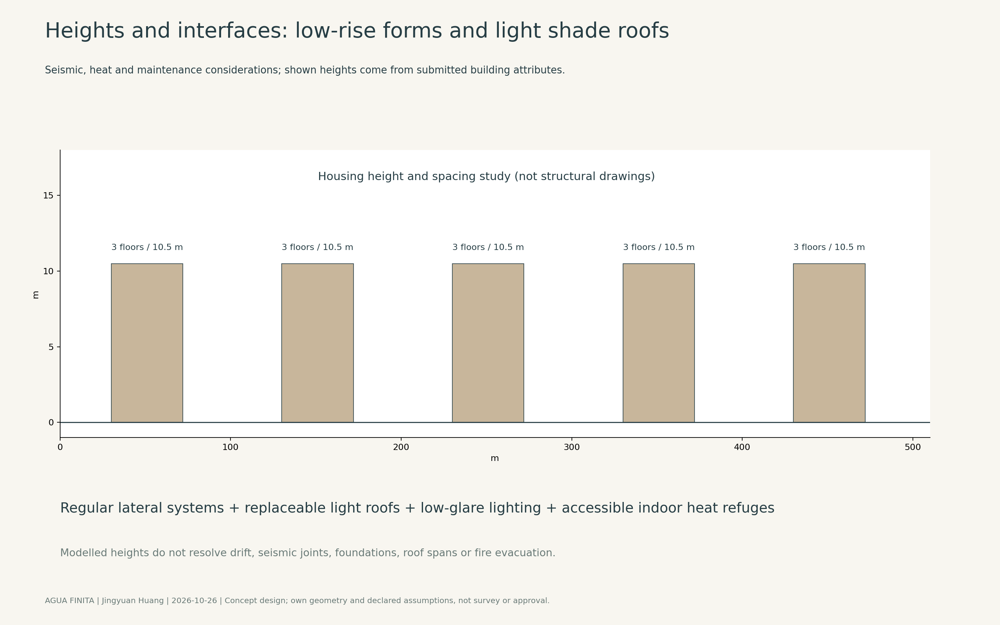

Short bars, protected occupied edges, filtered equipment intakes and maintainable porous screens address Zonda dust winds rather than an endless exposed monumental axis. Pale mineral ground, continuous roofs and limited drip planting prioritise routes and stopping places. Roof coverage of actual submitted public paths is 84.429%, not whole-site or all-day thermal comfort. Use shielded 2,200 K lighting without façade uplighting; the 10 lux route target still needs calculation. [A-SHADE]

Current building floor area is 311,343.1 m², study-envelope FAR 0.0077 and coverage 0.397%, with a stated denominator. Low envelope intensity largely reflects conditional reserves, not proof that the initial district is efficient or compact. Compare the first district, blocks and services separately; FAR alone establishes no spatial quality.

## 8. Governance and data

A proposed public-utility/community trust retains land, critical utilities, metering, public access and transferable controls, leasing service interfaces to replaceable compute operators. Its board includes resident, worker, engineering and independent-audit representation. This is a governance proposal, not an existing legal entity. [A-COST]

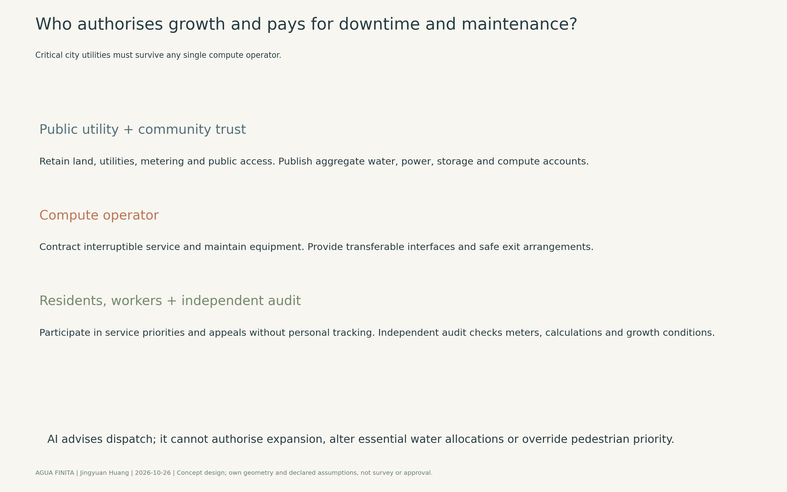

Record electricity, water, generation, storage state and aggregate compute utilisation hourly. Publish downloadable daily aggregates; reconcile fresh input, distribution, reuse and end use monthly. Independent annual engineering/accounting review tests meters and methods. Household consumption, personal movements and faces are excluded from public dispatch. Small-sample suppression and public correction procedures protect privacy.

AI may advise load and maintenance schedules; it cannot override essential water allocations, pedestrian priority, interfaces, audit findings or expansion approval. Keep manual/offline controls during failure. Failed metering suspends affected clean-energy claims and expansion; a model must not certify its own estimates.

Public utilities are not collateral for servers when an operator leaves. Contracts must secure server removal, data export/deletion, maintenance, safe exit, performance guarantees and service reserves. Operators can change; school, clinic, basic drinking water and road maintenance continue. Fixed service fees/reserves are proposed funding mechanisms, with amounts subject to cost and affordability verification rather than claimed raised funds. [A-COST]

## 9. Phasing

P1 is the complete first district and enabling access, not construction across the entire study envelope. Housing, school, clinic, kitchen, repairs, water/wastewater, basic power and emergency maintenance must operate before occupancy. The fixed living-quarter interior is unchanged; its demand, connection and own services require separate confirmation. [geometry/phasing.geojson]

P2 opens western/northern town and production-spine sections after 12 consecutive audited months with reliable water 20% above contracted demand, initial occupancy of 80%, funded school/health/maintenance services and verified corridor safety. Each section includes local processing, repairs, services and emergency support; the distant entire spine need not precede initial services. Shared power/communications/water reservations do not establish a water source, pressure or grid connection.

P3 opens D and E after binding trade demand, acceptable road/hydrology studies, reliable utility surplus and funded local services. Strict regional screening identifies approximately 2.64 km² for shared gateway/industry, below the indicative 7 km². Keep this gap visible. Verify eastern terraces, screening and route/land alternatives; do not fill conveyance space to meet an area figure. [A-V3]

| First-works package | Purpose | Start/acceptance condition | Retained if growth stops |
|---|---|---|---|
| Terrain, channels and rights | Establish deliverable construction/resource conditions | Source, specialist and rights verification | Traceable terrain/hydrology/rights record |
| External access and emergency response | Reach and maintain phase one | Alignment, rights, crossings and funding | Independent access/emergency service |
| Utilities and wastewater | Support actual initial demand | Lawful reliable supply, treatment and backup | Basic services independent of compute business |
| Housing and civic facilities | Complete everyday life | Funded capacity, operations and services | School, clinic, kitchen and homes |
| Processing, repair and compute | Contracted employment and services | Interruptible compute, heat-receiving and training agreements | Maintenance, metering and transferable assets |
| Later towns and gateway | Conditional expansion | Audited surplus, demand and engineering triggers | Unstarted land retained or used for low-investment study |

Accepted irreversible decisions include no speculative channel development, utility assets outside single-operator collateral, freight kept out of school grounds, and obligations attached to initial trenches/foundations. Batteries, servers and roofs should be replaceable, while maintenance, fire and removal need real design. Stopping growth during scarcity is preferable to funding today's services with speculative later land sales.

## 10. Key nodes

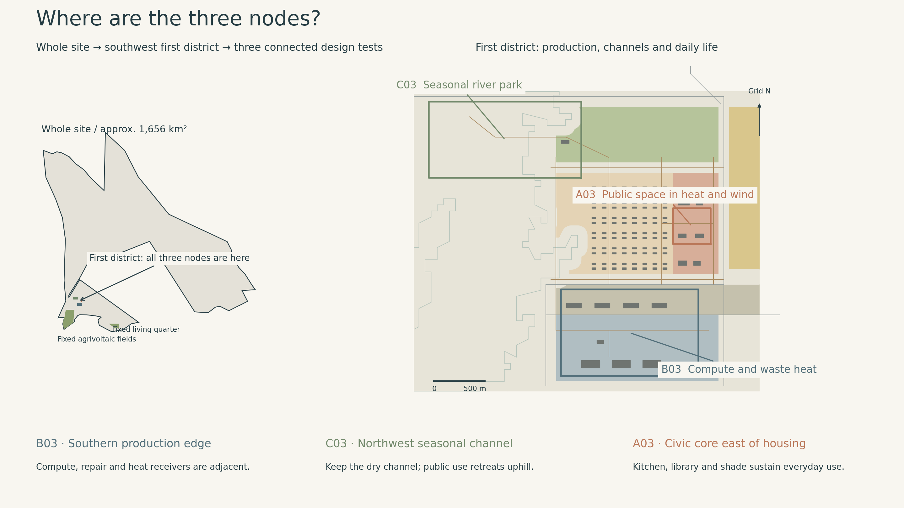

B03 at the southern production edge connects compute and maintenance. C03 at the northwest channel tests seasonal drainage. A03 east of housing supports public life. These are related places in the same district, not three random images. Later towns can reuse the testing method without copying objects.

### A03 · Public space in heat and Zonda wind

Kitchen, library, training/community facilities, continuous roofs and paths form the civic core east of housing. An approximately 270 × 152 m outer frame, 12 m edge-roof bands and central covered route prioritise movement and occupied edges. The open court is not fully shaded; extreme heat cannot support every activity. Drinking water, care, cleaning, visible exits and accessible indoor refuge are essential.

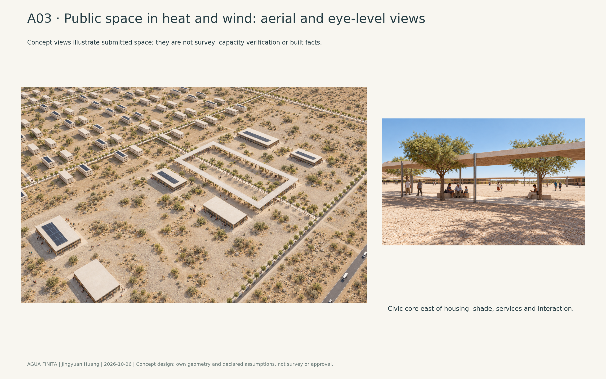
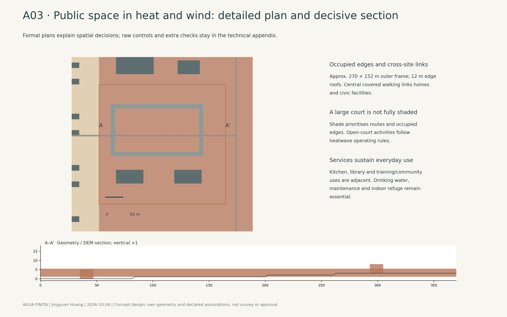

Morning walking/shopping, reduced midday outdoor stays and evening meeting/reading need different operating arrangements. Dust winds reduce activity and require protected intakes; basic access and staff service continue during outages. Limited drip trees do not prove all-day comfort, and shade does not guarantee safety with 50 °C ground conditions. [A-SHADE]

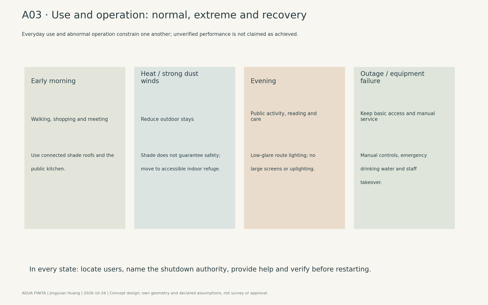

### B03 · A compute campus and its waste heat

Three 180 × 75 m single-storey halls occupy the southern service strip. Northern repair/processing and the 70 × 35 m receiver locate a real proposed heat use. Public routes meet a legible production edge without entering secured equipment yards. A diagrammatic heat link does not establish temperature, pipe diameter or pressure.

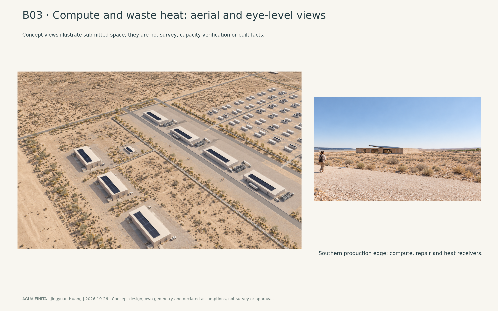
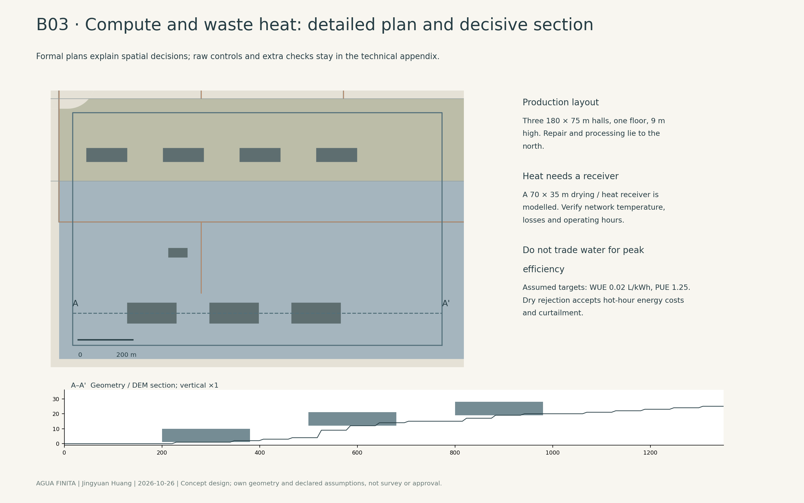

Morning handovers and drying preparation give way to hot-afternoon compute adjustment and water-shortage priorities. Paid reassignment/training should protect workers during curtailment. Metering/contracts must verify the 3,942 MWh/year heat target; disclose process/seasonal mismatch rather than declaring a closed loop with one arrow. [A-HEAT]

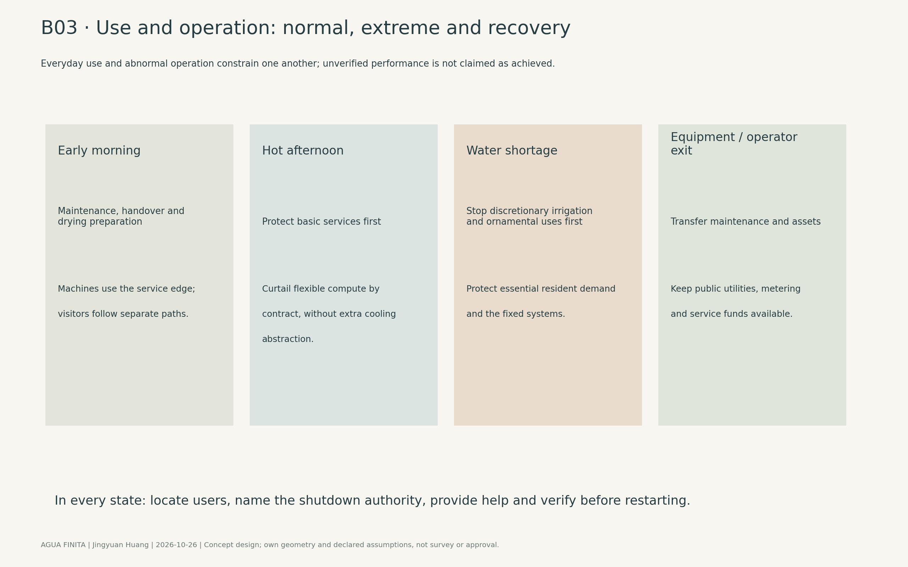

### C03 · A seasonal river park

Low ground retains dry channels and mineral surfaces. An 80 × 30 m water-education classroom sits on the eastern high-ground edge. Seasonal observation paths close at upstream warning; no one enters conveyance space during floods. Maintenance staff inspect erosion, sediment and damage before reopening. A blue lake does not substitute for this seasonal landscape.

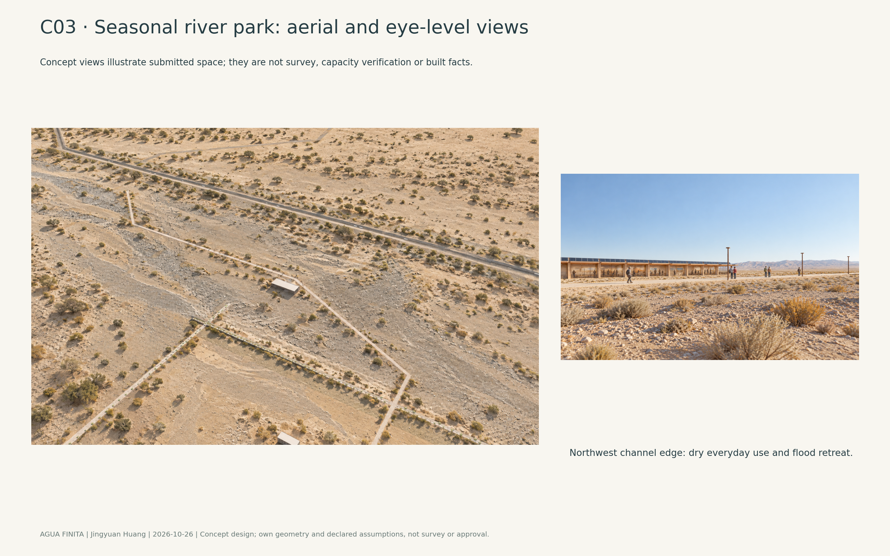
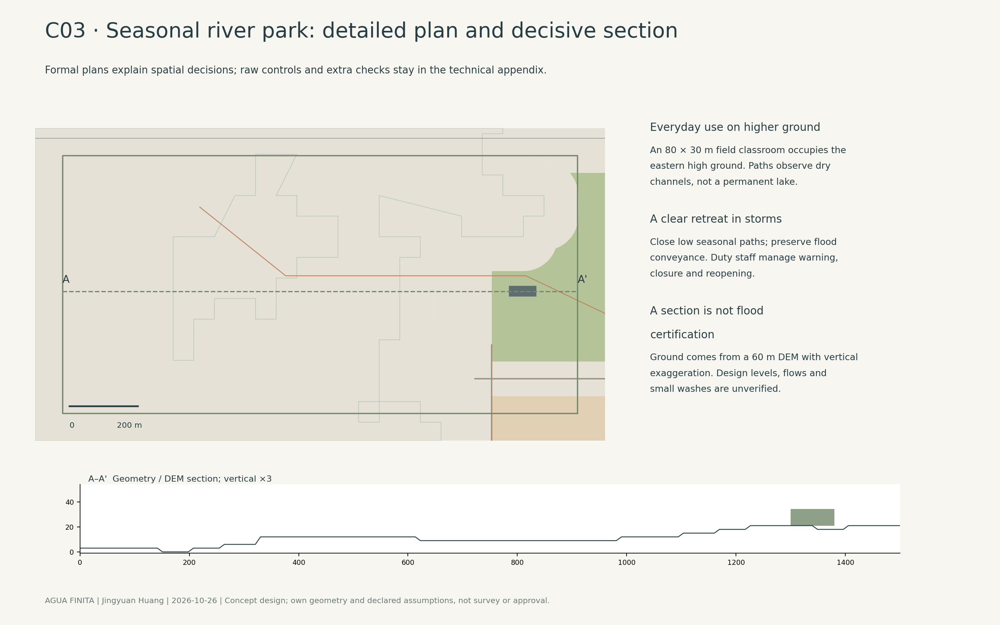

The 60 m DEM section explicitly exaggerates vertical scale; it is neither construction levels, design water level nor flood certification. Small washes, external catchments, warning time, soil and outfalls require professional field/hydrology studies. Public value comes from learning and retreat, not fixing the channel into year-round recreation.

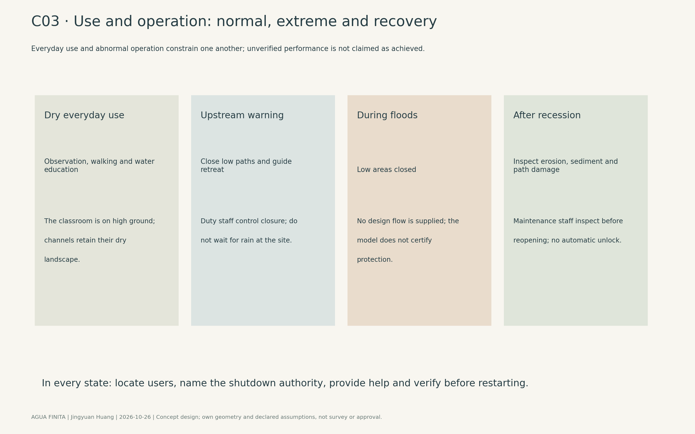

## 11. Metrics and evidence

Metrics are recomputed from current geometry/declarations. The scheme's dominant whole-site land account is mutually exclusive; operational co-use such as agrivoltaics is explained separately. System weights are not fixed land percentages. Reserve includes mountain, dryland, conveyance studies and unverified flood screening; it does not assign one permanent restriction to them all. [geometry/structure.geojson]

| Dominant whole-site study category | km² |
|---|---:|
| Agriculture and agrivoltaics | 481.567 |
| Energy and compute | 186.111 |
| Living and civic uses, including fixed living outline | 26.634 |
| Processing/manufacturing | 1.081 |
| Gateway/trade | 2.165 |
| Mountain, dryland, conveyance studies and flood screening | 959.128 |
| Total | 1656.686 |

| Key indicator | Current value | Scope |
|---|---:|---|
| Detailed study envelope | 40.5893 km² | Initial district and conditional expansion study, not built area |
| Building floor area | 311,343.1 m² | Submitted buildings, excluding light canopies |
| Envelope coverage / FAR | 0.397% / 0.0077 | Explicit study-envelope denominator |
| Additional homes / residents / jobs | 960 / 2,400 / 1,200 | Initial targets, excluding unknown fixed-quarter population |
| Annual gross water use | 1,000,000 m³ | Initial uses plus fixed-agriculture allowance |
| Peak / average IT | 12 MW / 9 MW | Assumed initial operating scenario |
| Fully matched hours | 62.432% | Synthetic 8,760-hour scenario |
| Clean-energy quantity share | 72.993% | Separate from matched-hour share |
| Walking-route roof coverage | 84.429% | Current routes, not whole-site thermal comfort |
| At-grade human-machine interfaces | 7 | Current registered geometry; reassess additions |

The main booklet keeps formal analysis, plans, decisive sections and finished concepts. Raw massing, additional comparisons, full calculations and evidence indexes occupy the technical appendix. The matrix links evidence and remaining work. Automatic gates check files, geometry, quantities and references, not spatial quality or approval.

## 12. Risks and failure modes

First, resources and access remain unsecured. Water rights, grid capacity, wastewater salinity, supply quality, external rights, crossings, seismic soil and fire requirements are conditions for construction, not resolved by a package pass. Verified fixed-quarter/pilot demand may reduce initial or expansion capacity. [A-WATER; A-ACCESS; A-SEISMIC]

Second, a regional model may be mistaken for engineering. A 300 m routing grid compares corridors but proves neither junction connectivity, turns, gradients nor drainage. A 60 m DEM cannot establish foundations or small washes. Seam closure changed area and prompted recomputation; old areas must not accompany new maps. Keep the indicative 7 km² versus approximately 2.64 km² gateway gap explicit. [A-V3]

Third, model governance and operator failure threaten service continuity. Faces, household behaviour profiles and automatic reputation scores must not determine essential services. Public records, independent audit, manual takeover, deletion and safe exit must actually work. Insufficient revenue, failed meters, heat-receiving shortfalls or water shortage trigger curtailment or paused growth, not relaxed basic guarantees.

The organiser/rights holders supply missing source and rights evidence. Licensed specialists verify hydrology, transport, civil, electricity, seismic and fire matters. The urban-design team completes expansion blocks, actual doors, facility capacity and service routes. Jingyuan Huang coordinates public records and revisions. Matrix `documented` means evidence supplied; `partial` identifies remaining work. Neither means approved.

## 13. Declared trade-off

This scheme does not maximise uninterrupted compute throughput or minimise cooling electricity. Protect essential life and fixed production under scarce water; accept higher hot-hour power and fewer saleable compute hours through dry rejection, interruptible contracts and a public water ledger. Investors, customers and operators bear the primary cost. Paid reassignment protects workers and independent service reserves protect residents from business volatility.

Spatially, accept longer links between settlements rather than continuous construction across dryland. Defer the gateway rather than asserting unverified 7 km² capacity. Acknowledge drainage uncertainty rather than making every screened hectare permanently protected or freely buildable. These decisions reduce immediate scale and visual completeness while preserving revision when real resource/engineering information arrives.

## 14. Sources, assumptions and AI disclosure

Current geometry, metrics, assumptions and sources form the evidence record. Organiser data and declared scenarios are distinguished throughout. Source geometry is not approval; generated concepts do not establish surveyed conditions, capacity, engineering feasibility or community consent. Exact generation prompts and control records remain in `image_provenance.json`, in their original working language.

Jingyuan Huang is the responsible party under jingyuanhuang-design. The manifest records a human-directed entry: the human selected the finite-water concept and nodes, reviewed and requested revisions, and authorised the earlier public upload and render-cover replacement. Codex authored geometry, calculations, text and visuals. This English migration changes presentation, not design geometry or node positions, and does not claim a new independent content-review pass.

The earlier version entered upstream through PR #5. V6 is a complete revision of that same entry, replacing the small-area-led account and six-page digest. Public presentation must use the same geometry, metrics, main booklet, appendix and version fingerprint. Source changes require renewed checks rather than a retained old PASS. The human-reading/evidence-layer organisation acknowledges the Haidian submission skill and Yunique-hub Open Gate Line as a method reference only; no peer text, geometry or imagery is reproduced. [S-HAIDIAN-PRESENTATION]

[Main booklet](drawings/a3-booklet.pdf) · [Technical appendix](drawings/a3-technical-appendix.pdf) · [Design-depth matrix](design_depth_matrix.json) · [Current automatic check](self_check.json)
